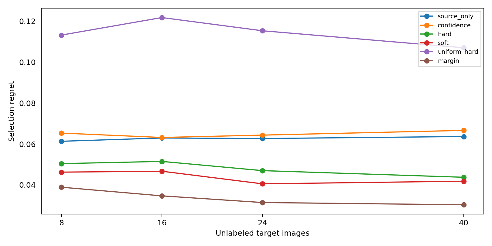
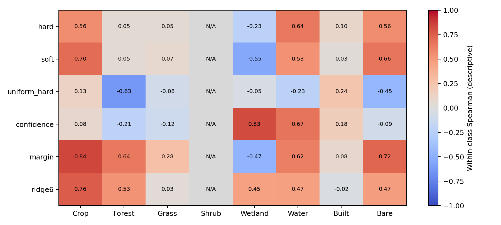

# U1 硬软伪标签FCDTM

本轮为历史池上的开发实验；预测没有访问目标真实标签。25模型/50任务，8/16/24张各五次加40张一次，共800子池。8/16/24是无标签图像预算；每次评价同一子池性能，不能与旧少标签外推口径直接比较。

## 预测与标签访问

25worker的Python/GDAL访问阻断探针及strace系统调用审计均需通过，完整预测封存后独立评价才打开目标标签。仅源域64图标签允许进入代理和原型；未读取旧目标真值缓存。审计不等同于OS强沙箱。源参考曾用于选优，来源不独立。

## 选择结果（8/16/24预算等权）

|方法|自身有效配置|遗憾|Top-1|最大损失|
|---|---:|---:|---:|---:|
|source_only|300|0.06230|0.61333|0.50816|
|ridge6|300|0.02334|0.74000|0.50816|
|margin|300|0.03500|0.72000|0.50816|
|confidence|300|0.06427|0.64000|0.52652|
|neg_entropy|300|0.05793|0.66333|0.52652|
|hard|300|0.04963|0.57667|0.52652|
|soft|300|0.04450|0.61333|0.52652|
|matched_hard|300|0.04940|0.64000|0.52652|
|matched_soft|300|0.07215|0.45667|0.52652|
|uniform_hard|300|0.11671|0.31000|0.66604|
|dual|300|0.04950|0.71333|0.57508|
|raw_hard|300|0.04963|0.57667|0.52652|

各法自身覆盖可能不同；全部方法共同候选配置见下表，不能通过删除不可算任务宣称更优。

|方法|共同配置|遗憾|Top-1|
|---|---:|---:|---:|
|source_only|300|0.06230|0.61333|
|ridge6|300|0.02334|0.74000|
|margin|300|0.03500|0.72000|
|confidence|300|0.06427|0.64000|
|neg_entropy|300|0.05793|0.66333|
|hard|300|0.04963|0.57667|
|soft|300|0.04450|0.61333|
|matched_hard|300|0.04940|0.64000|
|matched_soft|300|0.07215|0.45667|
|uniform_hard|300|0.11671|0.31000|
|dual|300|0.04950|0.71333|
|raw_hard|300|0.04963|0.57667|

## 全池40张（一次）

|方法|有效配置|遗憾|Top-1|
|---|---:|---:|---:|
|source_only|20|0.06364|0.55000|
|ridge6|20|0.02168|0.75000|
|margin|20|0.03032|0.75000|
|confidence|20|0.06663|0.65000|
|neg_entropy|20|0.05100|0.70000|
|hard|20|0.04375|0.65000|
|soft|20|0.04183|0.60000|
|matched_hard|20|0.06250|0.60000|
|matched_soft|20|0.07089|0.45000|
|uniform_hard|20|0.10697|0.30000|
|dual|20|0.04187|0.80000|
|raw_hard|20|0.04375|0.65000|

U1原生分数没有AD单位，没有用目标标签拟合比例，也未将beta1换算当作AD预测。hard/soft使用真源原型与伪目标分组，matched使用源目标一致预测分组，uniform_hard去掉头方向；它们不是原式可无标签计算的证明。

## 解释要求

必须分别比较权重与无权重、margin-only及置信度，不将仅优于源F1先验当作权重贡献。没有事后调公式、翻转方向、挑类别。空硬前景、相对均值分母非有限、F1分母为零分开记录为缺失，不补0；相关CSV包含覆盖率。单候选组不计选择增益。

8类和两个迁移场景均保留；当前未做新的独立区域确认。标签零访问不保证可识别所有错误，源概率在目标上可能失准，高置信预测也可能错。伪标签不是准确率证据。

## 首轮结果的判断

硬伪标签原式变体选择遗憾0.049632、Top-1 57.67%；软版0.044501/61.33%。相同硬分组无权重为0.116714/31.00%，说明头权重方向在这一原式变体中含有排序信息。硬/软的遗憾低于原生置信度0.064275，但命中率低于置信度64.00%；不能只报有利指标。

最强无标签选择基线是源6维错误代理ridge6（0.023341/74.00%），原式替代尚未超过它；margin-only风险也更强（0.034999/72.00%）。soft尚无同软分组的无权重消融，不能把全部soft收益归给权重。原生分数不做AD数值宣称。

主比较样本数、全部失败与40图结果见CSV。所有主比较均300/300，不存在靠删除失败候选获得本轮主要增益。主比较口径说明在评价前已写于本地，但因网络超时补传较晚；本轮全部方法交集同样完整，口径没有改变所报主数值。

## 类别内相关性补充

每个预算/重复内，按类别在不同源—目标任务间计算Spearman，再对重复及8/16/24预算等权。分数方向均统一为高值表示高目标F1。少于3任务或常量时N/A，不填0；灰色不是失败分数。40图相关另存CSV。

这不是同目标候选组的选择正确率，跨任务/源模型尺度仍可能影响相关；重复共享数据，不作显著性检验。不将混类高相关代替同类选模证据。

