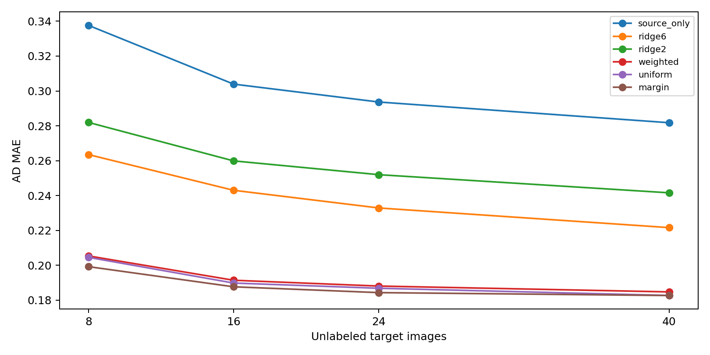
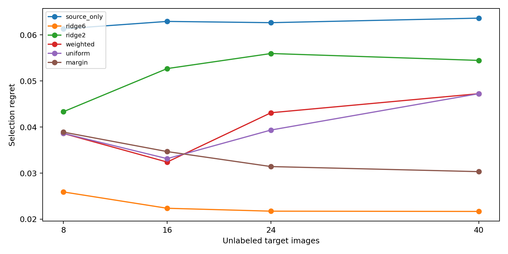

# U2 权重引导双侧源风险

本轮为历史池上的开发实验；预测没有访问目标真实标签。25模型/50任务，8/16/24张各五次加40张一次，共800子池。8/16/24是无标签图像预算；每次评价同一子池性能，不能与旧少标签外推口径直接比较。

## 预测与标签访问

25worker的Python/GDAL访问阻断探针及strace系统调用审计均需通过，完整预测封存后独立评价才打开目标标签。仅源域64图标签允许进入代理和原型；未读取旧目标真值缓存。审计不等同于OS强沙箱。源参考曾用于选优，来源不独立。

## 选择结果（8/16/24预算等权）

|方法|自身有效配置|遗憾|Top-1|最大损失|
|---|---:|---:|---:|---:|
|source_only|300|0.06230|0.61333|0.50816|
|ridge6|300|0.02334|0.74000|0.50816|
|ridge2|300|0.05066|0.65333|0.50816|
|weighted|300|0.03804|0.71667|0.50816|
|uniform|300|0.03704|0.71333|0.50816|
|margin|300|0.03500|0.72000|0.50816|
|confidence|300|0.06427|0.64000|0.52652|
|neg_entropy|300|0.05793|0.66333|0.52652|

各法自身覆盖可能不同；全部方法共同候选配置见下表，不能通过删除不可算任务宣称更优。

|方法|共同配置|遗憾|Top-1|
|---|---:|---:|---:|
|source_only|300|0.06230|0.61333|
|ridge6|300|0.02334|0.74000|
|ridge2|300|0.05066|0.65333|
|weighted|300|0.03804|0.71667|
|uniform|300|0.03704|0.71333|
|margin|300|0.03500|0.72000|
|confidence|300|0.06427|0.64000|
|neg_entropy|300|0.05793|0.66333|

## 全池40张（一次）

|方法|有效配置|遗憾|Top-1|
|---|---:|---:|---:|
|source_only|20|0.06364|0.55000|
|ridge6|20|0.02168|0.75000|
|ridge2|20|0.05447|0.60000|
|weighted|20|0.04724|0.70000|
|uniform|20|0.04724|0.70000|
|margin|20|0.03032|0.75000|
|confidence|20|0.06663|0.65000|
|neg_entropy|20|0.05100|0.70000|

## AD预测MAE

|分组|值|方法|共同配置|MAE|
|---|---:|---:|---:|---:|
|budget|8|source_only|250|0.33763|
|budget|8|ridge6|250|0.26351|
|budget|8|ridge2|250|0.28196|
|budget|8|weighted|250|0.20539|
|budget|8|uniform|250|0.20457|
|budget|8|margin|250|0.19923|
|budget|16|source_only|250|0.30392|
|budget|16|ridge6|250|0.24302|
|budget|16|ridge2|250|0.25989|
|budget|16|weighted|250|0.19142|
|budget|16|uniform|250|0.18982|
|budget|16|margin|250|0.18766|
|budget|24|source_only|250|0.29366|
|budget|24|ridge6|250|0.23288|
|budget|24|ridge2|250|0.25198|
|budget|24|weighted|250|0.18809|
|budget|24|uniform|250|0.18682|
|budget|24|margin|250|0.18433|
|budget|40|source_only|50|0.28178|
|budget|40|ridge6|50|0.22161|
|budget|40|ridge2|50|0.24157|
|budget|40|weighted|50|0.18474|
|budget|40|uniform|50|0.18270|
|budget|40|margin|50|0.18266|
|scenario|sensor|source_only|375|0.15132|
|scenario|sensor|ridge6|375|0.13563|
|scenario|sensor|ridge2|375|0.13575|
|scenario|sensor|weighted|375|0.09762|
|scenario|sensor|uniform|375|0.09771|
|scenario|sensor|margin|375|0.10339|
|scenario|region|source_only|375|0.47215|
|scenario|region|ridge6|375|0.35731|
|scenario|region|ridge2|375|0.39347|
|scenario|region|weighted|375|0.29230|
|scenario|region|uniform|375|0.28976|
|scenario|region|margin|375|0.27742|
|overall|overall|source_only|750|0.31174|
|overall|overall|ridge6|750|0.24647|
|overall|overall|ridge2|750|0.26461|
|overall|overall|weighted|750|0.19496|
|overall|overall|uniform|750|0.19374|
|overall|overall|margin|750|0.19040|

## 解释要求

必须分别比较权重与无权重、margin-only及置信度，不将仅优于源F1先验当作权重贡献。没有事后调公式、翻转方向、挑类别。空硬前景、相对均值分母非有限、F1分母为零分开记录为缺失，不补0；相关CSV包含覆盖率。单候选组不计选择增益。

8类和两个迁移场景均保留；当前未做新的独立区域确认。标签零访问不保证可识别所有错误，源概率在目标上可能失准，高置信预测也可能错。伪标签不是准确率证据。

## 首轮结果的判断

加权双侧风险AD MAE=0.194963，低于源先验0.311738，但高于同容量无权重0.193736和margin-only 0.190404。加权选模遗憾0.038041，也未超过无权重0.037044、margin-only 0.034999或ridge6 0.023341。本轮不支持新增权重距离的独立增益。

跨传感器加权MAE0.097624，略低于margin-only的0.103390，但几乎与无权重0.097710相同；跨地域加权0.292302，高于margin-only的0.277418。不能据跨传感器局部改善就宣称头权重必需。40图完整池加权MAE0.184737，无权重0.182704，margin-only 0.182663；覆盖更充分仍未产生独立优势。

8/16/24的真实评价对象是各自子池，40图是完整部署池；随着图像数增加指标变化也包含真实子池组成变化，不能把下降曲线解释成固定总体上已证明收敛。没有目标标签的source-risk不具E13目标残差校正，数值不得直接与少标签旧实验作同条件比较。

主比较样本数、全部失败与40图结果见CSV。所有主比较均300/300，不存在靠删除失败候选获得本轮主要增益。主比较口径说明在评价前已写于本地，但因网络超时补传较晚；本轮全部方法交集同样完整，口径没有改变所报主数值。
