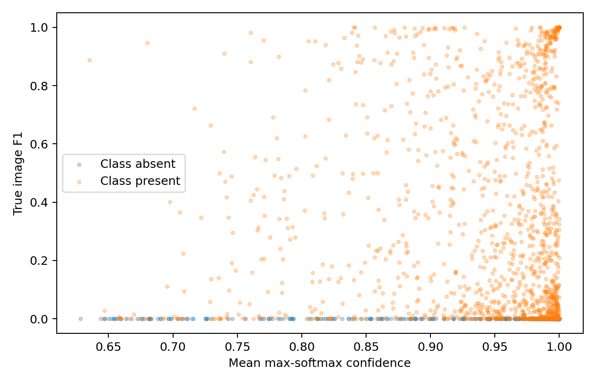

# U3 首轮伪标签与概率失配诊断

这是封存后的机制诊断，不是新方法测试或适用条件确认。完整的增强一致性/伪标签筛选尚未执行。

{
 "images": 2000,
 "defined_F1": 1769,
 "undefined_F1": 231,
 "hard_empty": 277,
 "true_empty": 598,
 "high_conf_low_F1": 804,
 "high_conf_low_F1_with_true_foreground": 547,
 "diagnosis_only": true
}

逐图数共用模型/影像，不能当独立样本显著性证据。F1未定义不补0；高置信低F1既可来自类别缺失也可来自真实前景错误，两种计数分开。源验证Brier好也不能保证目标条件关系稳定。

