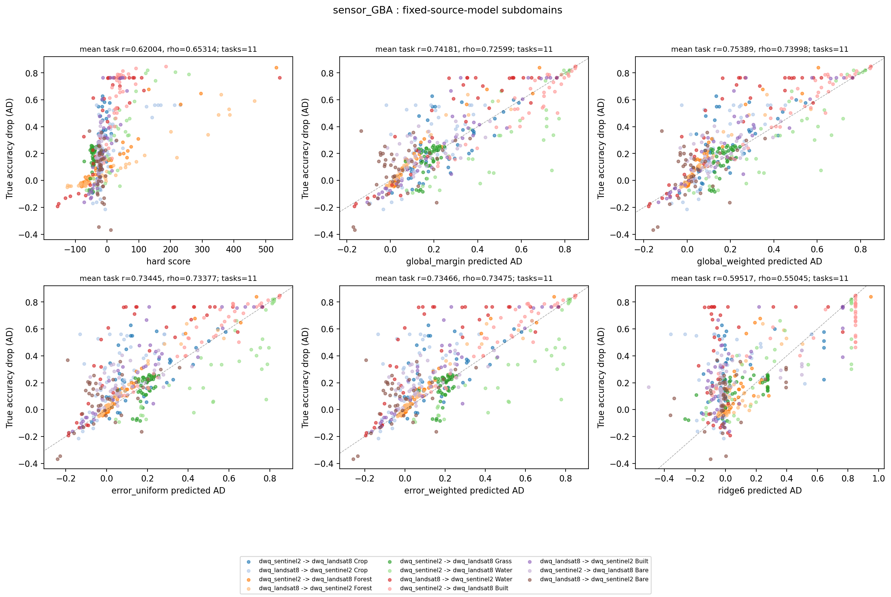
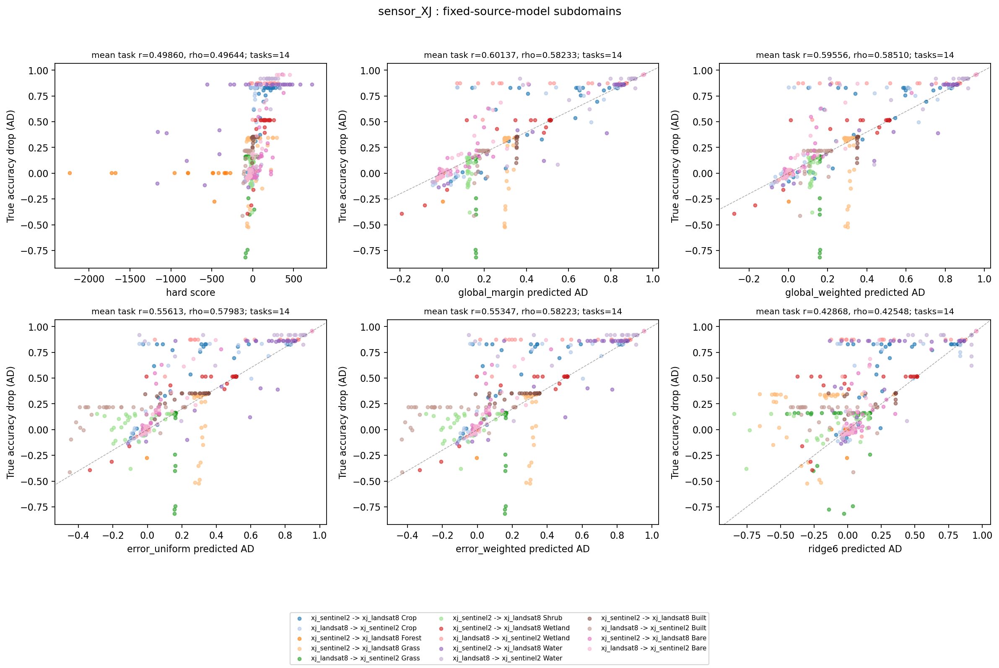

> 论文主验证使用每子域4图，见[四图结果分析](论文四图子域结果分析.md)。本文件保留单图敏感性及8/16/24图池选择结果。

# U5 源域错误状态参考：实验结果分析

## 目的与过程

仅源域建立TN/FN/FP/TP特征原型，固定512像素层级收缩，再按预测侧校准误差概率；目标无真实标签，无目标混合比例拟合。冻结25模型/50任务，访问审计通过后封存，独立评价。沿论文main.tex式12–17，AD=F1s−F1t，每个256×256图为目标子域；与原论文相同的误差下降量和相关指标，但当前是历史开发池。

## 论文式相关比较

六面板方法使用相同有限点和可定义相关的任务交集：50/50任务。常量任务和不足3点记N/A，不填0、取绝对值或看图翻号。Spearman对并列用平均秩。

|分组|方法|任务|Pearson r|Spearman rho|
|---|---|---:|---:|---:|
|all|error_weighted|50|0.46810|0.48481|
|all|error_uniform|50|0.46592|0.47997|
|all|global_margin|50|0.48283|0.47043|
|all|global_weighted|50|0.50204|0.49169|
|all|ridge6|50|0.34923|0.34675|
|all|hard|50|0.43317|0.43628|
|region_S2|error_weighted|14|0.26838|0.24993|
|region_S2|error_uniform|14|0.25532|0.22859|
|region_S2|global_margin|14|0.25253|0.22364|
|region_S2|global_weighted|14|0.33792|0.29043|
|region_S2|ridge6|14|0.18835|0.18673|
|region_S2|hard|14|0.36221|0.35542|
|region_L8|error_weighted|11|0.34707|0.40981|
|region_L8|error_uniform|11|0.35060|0.41902|
|region_L8|global_margin|11|0.36607|0.38654|
|region_L8|global_weighted|11|0.34005|0.38068|
|region_L8|ridge6|11|0.20692|0.24653|
|region_L8|hard|11|0.25334|0.24576|
|sensor_GBA|error_weighted|11|0.73466|0.73475|
|sensor_GBA|error_uniform|11|0.73445|0.73377|
|sensor_GBA|global_margin|11|0.74181|0.72599|
|sensor_GBA|global_weighted|11|0.75389|0.73998|
|sensor_GBA|ridge6|11|0.59517|0.55045|
|sensor_GBA|hard|11|0.62004|0.65314|
|sensor_XJ|error_weighted|14|0.55347|0.58223|
|sensor_XJ|error_uniform|14|0.55613|0.57983|
|sensor_XJ|global_margin|14|0.60137|0.58233|
|sensor_XJ|global_weighted|14|0.59556|0.58510|
|sensor_XJ|ridge6|14|0.42868|0.42548|
|sensor_XJ|hard|14|0.49860|0.49644|

## 论文式散点图

横轴原式hard为无标签FCDTM分数，其他面板为预测AD；纵轴均为真实AD。颜色表示类别与迁移方向。1:1线仅用于有AD单位的预测。图中相关为任务内相关的等权均值，不能从混类云团形状推断选模价值。

每个任务的独立六面板图见artifacts/figures/task_*.png/pdf；task_centered_diagnostic为任务去均值诊断，明确为描述性，不代替逐任务相关。

## AD误差与模型选择（8/16/24预算等权）

|方法|AD MAE|选择遗憾|Top-1|最大损失|
|---|---:|---:|---:|---:|
|error_weighted|0.22358|0.04027|0.70000|0.50816|
|error_uniform|0.22528|0.04055|0.70000|0.50816|
|conditional_margin|0.23752|0.04638|0.68000|0.64707|
|global_margin|0.19040|0.03500|0.72000|0.50816|
|global_weighted|0.19496|0.03804|0.71667|0.50816|
|global_uniform|0.19374|0.03704|0.71333|0.50816|
|ridge6|0.24647|0.02334|0.74000|0.50816|
|source_only|0.31174|0.06230|0.61333|0.50816|

各方法有效点、相关可定义任务、子池覆盖、分预算与40图结果见CSV。源原式分数无AD单位，不汇报虚假数值预测误差。目标F1分母0的图不补0，缺失数量单列；候选不可算不缩小候选池。

## 限制与结论要求

比较error_weighted、error_uniform、conditional_margin，以区分错误状态距离、预测侧拆分和权重作用；同时必须面对global_margin和ridge6强基线。原型误差样本少会回退，源条件错误分布未必跨域稳定。当前数据不独立，不按2000图像—模型记录或重复预算声称独立显著性。所有方法参数和图形方向固定，评价绘图不反馈校准。目标混合比例阶段本次未执行。

## 首轮结果判断与核验补充

- error_weighted相对error_uniform：MAE变化（正=退化）-0.001704；选择遗憾变化-0.000280。
- error_weighted相对conditional_margin：MAE变化（正=退化）-0.013942；选择遗憾变化-0.006119。
- error_weighted相对global_margin：MAE变化（正=退化）0.033174；选择遗憾变化0.005266。
- error_weighted相对ridge6：MAE变化（正=退化）-0.022893；选择遗憾变化0.016925。

### 与条件margin的同任务公平相关

|场景|方法|共同任务|r|rho|
|---|---|---:|---:|---:|
|all|error_weighted|50|0.47297|0.49048|
|all|error_uniform|50|0.47074|0.48556|
|all|conditional_margin|50|0.45514|0.47050|
|all|global_margin|50|0.48830|0.48000|
|region_S2|error_weighted|14|0.27129|0.25383|
|region_S2|error_uniform|14|0.25816|0.23276|
|region_S2|conditional_margin|14|0.26572|0.24076|
|region_S2|global_margin|14|0.25548|0.22851|
|region_L8|error_weighted|11|0.35581|0.42908|
|region_L8|error_uniform|11|0.35927|0.43816|
|region_L8|conditional_margin|11|0.30499|0.37590|
|region_L8|global_margin|11|0.37425|0.40592|
|sensor_GBA|error_weighted|11|0.73653|0.73957|
|sensor_GBA|error_uniform|11|0.73634|0.73873|
|sensor_GBA|conditional_margin|11|0.72383|0.73091|
|sensor_GBA|global_margin|11|0.74532|0.73181|
|sensor_XJ|error_weighted|14|0.55962|0.57965|
|sensor_XJ|error_uniform|14|0.56221|0.57670|
|sensor_XJ|conditional_margin|14|0.55142|0.56995|
|sensor_XJ|global_margin|14|0.60881|0.59185|

这张补充表对四种误差风险控制使用共同有限点和共同可定义任务；主六面板表另含原式hard，因空伪前景/常量不同，交集可能更小。不得跨不同交集的均值直接宣称增益。高r/rho不保证AD校准或低选择遗憾。

图形仅重绘轴域使各面板显示相同真实AD范围；原预测、散点、r/rho均不变，1:1线若在可见区域之外不强制扩轴。原图代码与独立重绘代码都保留。源64图曾用于历史选优，源fit/cal/test只是度量器内部划分，不是分割模型的全新OOF源验证。

误差概率是P(真实背景|预测前景)和P(真实前景|预测背景)，分别对应预测侧错误后验，不等于以真实类别为分母的FPR/FNR。此区别不影响通过概率构造TP/FP/FN，但应避免混称。
