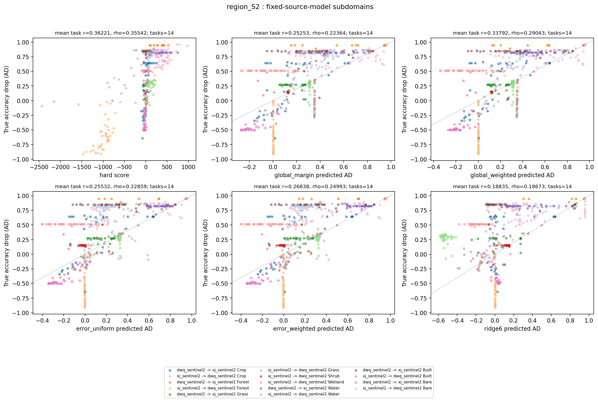
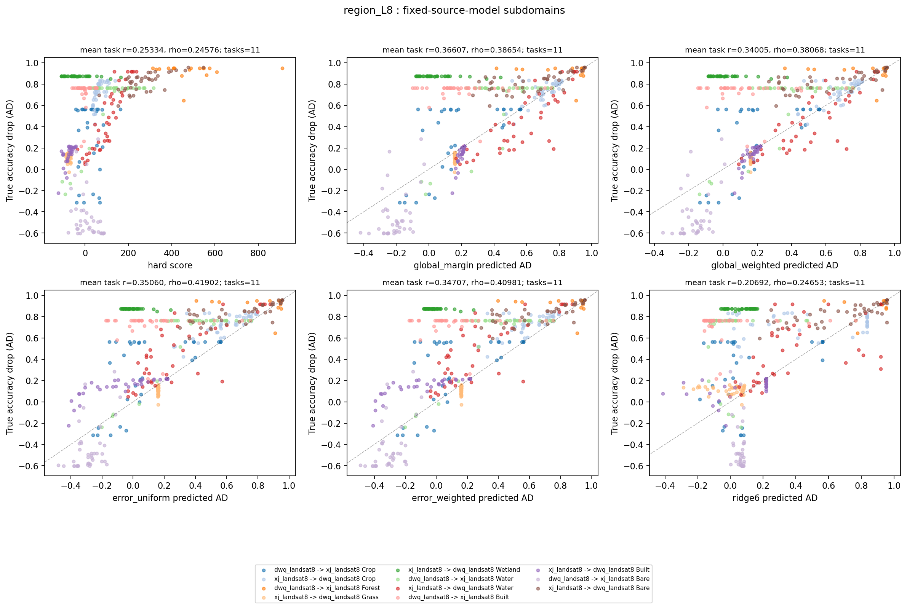

# U5 补充结果：逐张图分析与8／16／24图模型选择

> **主结论请先读[通俗版主报告](论文四图子域结果分析.md)。** 原论文每4张图组成一个子域，因此四图结果才是主验证。本文件保留早期逐图分析，方便检查分组方式是否影响结论；它不是另一套新实验。

## 1. 为什么会有两份结果？

最初程序把每张256×256图作为一个评价单位，每任务最多40个点，共2000条图像—模型记录。程序完成后核对原文，发现论文用4张图组成一个子域，于是改为先汇总4张图的正确识别、误报、漏检数量，再计算F1。主报告采用修正后的四图结果。

两种分析使用相同模型、影像和已保存的预测，没有据此重新训练、微调或修改参数。分组变了，F1比值和相关值会变，所以两份表不应混用。重复使用相同数据，也不等于得到两份独立验证证据。

## 2. 逐图结果告诉了我们什么？

下表比较主六面板方法都能计算的图像点，再在共同可定义相关的50个任务上平均。r看预测下降和真实下降是否一起变化；rho看同一模型在各张图上的下降顺序。数值越接近1通常越好，但高相关不保证具体下降量估得准，也不等于会选候选模型。

|场景|U5新方法r|U5新方法rho|
|---|---:|---:|
|全部任务|0.46810|0.48481|
|大湾区跨传感器|0.73466|0.73475|
|新疆跨传感器|0.55347|0.58223|
|S2跨地域|0.26838|0.24993|
|L8跨地域|0.34707|0.40981|

逐图分析同样表现为跨传感器较好、跨地域较弱。但不能因为逐图相关高于四图相关，就只报告逐图数字；按原论文验证方式，应以主报告为准。

`error_weighted`是U5新方法，`error_uniform`是同容量无权重对照，`global_margin`是全局分类间隔对照，`global_weighted`是旧加权对照，`ridge6`是六统计量回归，`hard`是硬伪标签代入原FCDTM形式。更完整的方法解释及指标示例见主报告第5—6节。

## 3. 8、16、24张影像的模型选择结果

这里的预算指**无标签目标影像数量**。每种数量抽取5次，同一配置中各方法面对相同影像和候选模型。另有40张完整图池结果，保存在CSV中。

MAE看F1下降量估得准不准；选择遗憾看选中模型距离本次最优候选差多少；Top-1看选中最优候选的比例；最大损失看最严重一次选错造成的F1损失。详细例子见主报告第9节。

|方法|AD误差MAE↓|选择遗憾↓|Top-1↑|最大损失↓|
|---|---:|---:|---:|---:|
|U5新方法 `error_weighted`|0.22358|0.04027|70.0%|0.50816|
|无权重 `error_uniform`|0.22528|0.04055|70.0%|0.50816|
|只看间隔、分两侧 `conditional_margin`|0.23752|0.04638|68.0%|0.64707|
|全局间隔 `global_margin`|0.19040|0.03500|72.0%|0.50816|
|旧加权 `global_weighted`|0.19496|0.03804|71.7%|0.50816|
|旧无权重 `global_uniform`|0.19374|0.03704|71.3%|0.50816|
|六统计量回归 `ridge6`|0.24647|**0.02334**|**74.0%**|0.50816|
|假设精度不变 `source_only`|0.31174|0.06230|61.3%|0.50816|

新方法比只看间隔并分两侧的方法好一些，但没有超过全局间隔的精度预测，也没有超过六统计量回归的选模能力。加权和无权重版本的Top-1相同，不能据此认定权重发挥了明显作用。

选择遗憾0.04027可以理解为：按本实验平均方式，选中模型比该次最优候选的F1低约4.0个百分点。但最严重一次仍损失约50.8个百分点，平均值没有消除大损失风险。

表中误差按源模型—迁移任务汇总，选择指标按类别—目标域汇总，再对预算等权平均。并列候选按固定规则分摊；候选不可计算时不偷偷删除该候选后继续选择。不能把Top-1简单解读为独立重复试验的成功率。

## 4. 逐图散点图怎么读？

纵轴是真实AD。除`hard`面板外，横轴是预测AD；接近虚线表示数值预测更准，虚线上方表示低估了实际下降。`hard`横轴没有AD单位，不用1:1线判断。各颜色代表类别和方向，图上r、rho是任务内算出后平均的结果。

下面四张仅为逐图补充图；[主报告](论文四图子域结果分析.md)中的四图子域图用于论文式主验证。

逐任务PNG/PDF及“任务去均值”描述图见[图表索引](图表索引.md)。后者只是辅助观察，不代替任务内相关或选模实验。

## 5. 完整逐图相关表

场景代码和方法代码在主报告中有中文对照。以下为包含原式`hard`的六面板共同点比较。

|分组|方法|任务|Pearson r|Spearman rho|
|---|---|---:|---:|---:|
|all|error_weighted|50|0.46810|0.48481|
|all|error_uniform|50|0.46592|0.47997|
|all|global_margin|50|0.48283|0.47043|
|all|global_weighted|50|0.50204|0.49169|
|all|ridge6|50|0.34923|0.34675|
|all|hard|50|0.43317|0.43628|
|region_S2|error_weighted|14|0.26838|0.24993|
|region_S2|error_uniform|14|0.25532|0.22859|
|region_S2|global_margin|14|0.25253|0.22364|
|region_S2|global_weighted|14|0.33792|0.29043|
|region_S2|ridge6|14|0.18835|0.18673|
|region_S2|hard|14|0.36221|0.35542|
|region_L8|error_weighted|11|0.34707|0.40981|
|region_L8|error_uniform|11|0.35060|0.41902|
|region_L8|global_margin|11|0.36607|0.38654|
|region_L8|global_weighted|11|0.34005|0.38068|
|region_L8|ridge6|11|0.20692|0.24653|
|region_L8|hard|11|0.25334|0.24576|
|sensor_GBA|error_weighted|11|0.73466|0.73475|
|sensor_GBA|error_uniform|11|0.73445|0.73377|
|sensor_GBA|global_margin|11|0.74181|0.72599|
|sensor_GBA|global_weighted|11|0.75389|0.73998|
|sensor_GBA|ridge6|11|0.59517|0.55045|
|sensor_GBA|hard|11|0.62004|0.65314|
|sensor_XJ|error_weighted|14|0.55347|0.58223|
|sensor_XJ|error_uniform|14|0.55613|0.57983|
|sensor_XJ|global_margin|14|0.60137|0.58233|
|sensor_XJ|global_weighted|14|0.59556|0.58510|
|sensor_XJ|ridge6|14|0.42868|0.42548|
|sensor_XJ|hard|14|0.49860|0.49644|

## 6. 为什么下面还有一张相关表？

下面只比较新方法、无权重、分两侧间隔和全局间隔四种方法。它们共同能计算的图像点，与上面还包含`hard`的六面板不完全相同，所以相关值略有区别。**应在同一张表内比较，不能从两张表各挑一个数字来证明优势。** 两张表均保持原始结果，没有重新挑样本。

|场景|方法|共同任务|r|rho|
|---|---|---:|---:|---:|
|all|error_weighted|50|0.47297|0.49048|
|all|error_uniform|50|0.47074|0.48556|
|all|conditional_margin|50|0.45514|0.47050|
|all|global_margin|50|0.48830|0.48000|
|region_S2|error_weighted|14|0.27129|0.25383|
|region_S2|error_uniform|14|0.25816|0.23276|
|region_S2|conditional_margin|14|0.26572|0.24076|
|region_S2|global_margin|14|0.25548|0.22851|
|region_L8|error_weighted|11|0.35581|0.42908|
|region_L8|error_uniform|11|0.35927|0.43816|
|region_L8|conditional_margin|11|0.30499|0.37590|
|region_L8|global_margin|11|0.37425|0.40592|
|sensor_GBA|error_weighted|11|0.73653|0.73957|
|sensor_GBA|error_uniform|11|0.73634|0.73873|
|sensor_GBA|conditional_margin|11|0.72383|0.73091|
|sensor_GBA|global_margin|11|0.74532|0.73181|
|sensor_XJ|error_weighted|14|0.55962|0.57965|
|sensor_XJ|error_uniform|14|0.56221|0.57670|
|sensor_XJ|conditional_margin|14|0.55142|0.56995|
|sensor_XJ|global_margin|14|0.60881|0.59185|

## 7. 限制与技术备注

预测阶段不读目标标签，先保存预测再独立读取真值核对。当前仍是历史开发池，源64图也曾参与模型选优，并非全新独立区域或分割模型的全新验证集。逐图2000条记录共用影像和模型，不是2000个相互独立实验。

新方法使用的“典型特征”来自源域平均参考。某种错误样本少时，会把它的平均特征向较充分的同侧参考拉近，避免少量像素决定全部结果；这一稳定措施固定为512像素强度，但也可能减弱正确／错误的区别。源域学到的错误规律不保证在目标域继续成立。

本方法的两种错误概率，分别以“预测前景”和“预测背景”为分母，不是通常以真实类别为分母的假阳性率FPR、假阴性率FNR。通俗地说，它估的是“模型这样预测的像素里，有多少预测错了”。

真实F1分母为0时记N/A，不补0；相关所需的变化不存在或可用点不足时，也记N/A。各方法覆盖、分预算和40图结果见artifacts下CSV。图形轴范围调整只影响显示，不改变数据。U5没有进行目标混合比例估计。
