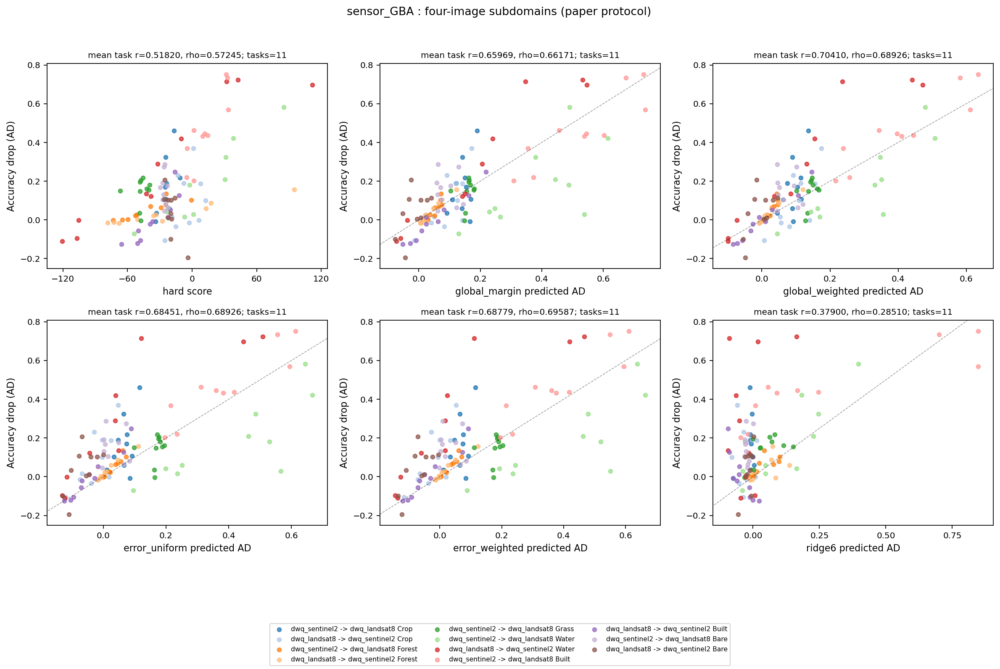
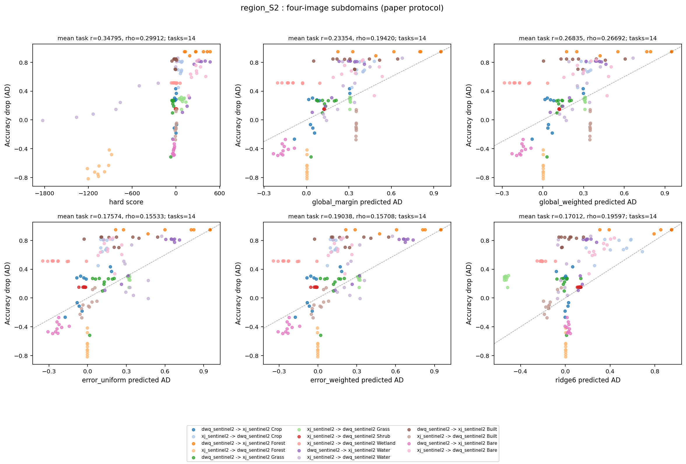
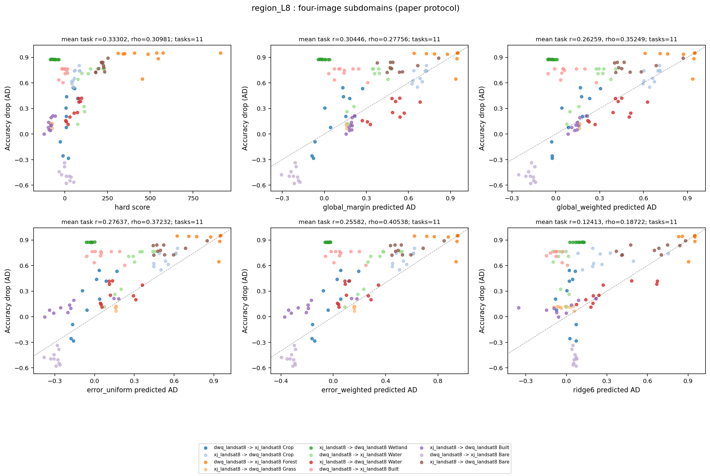

# U5 实验结果分析：不看目标标签，能否判断模型迁移后会变差多少？

> 建议先读这份主报告。这里采用原论文“4张图组成一个子域”的验证方式。[另一份报告](实验结果分析.md)保留逐张图的补充结果。本次只改写说明，原始预测、数字和图表均未改变。

## 1. 先看结论

**U5的方法有一定预测能力，但还没有超过现有的较强对照方法，也没有证明模型权重带来了稳定的额外收益。**

具体来说：加入源域“正确和错误样本长什么样”的参考后，比只看模型分类间隔的方法更准一些；但仍不如较简单的全局分类间隔方法。新方法在跨传感器任务中能较好地跟踪精度下降的变化，在跨地域任务中明显较弱。

这里的“跨传感器表现较好”，是指它在这类任务中的表现优于自身在跨地域的表现，不能理解成它已经胜过所有对照方法。

## 2. 这个实验究竟要解决什么问题？

假设有一个在大湾区影像上训练好的水体模型。现在想把它用于另一种传感器的影像，或者用于新疆。我们不微调模型，也不给评估算法看目标地区的真实标签，但希望提前知道：**模型到了新数据上，F1会下降多少？**

U5的思路是：先在有标签的源域中观察模型通常在哪里判断正确、在哪里出错，再看目标影像中的特征像不像这些参考，从而估计目标表现。

这个过程分两步：先完成并保存所有预测，再由独立评价程序读取目标真实标签，检查预测是否准确。真实标签只用于最后“核对答案”，没有用于生成预测。25个模型的预测进程均通过了标签访问审计。

## 3. 新方法是怎样做的？

以“水体／非水体”为例，源域有真实标签，所以可以把像素分成四组。

|源域中的情况|含义|代码简称|
|---|---|---|
|实际是水体，也预测成水体|正确识别了水体|TP|
|实际不是水体，却预测成水体|误报|FP|
|实际是水体，却预测成非水体|漏检|FN|
|实际不是水体，也预测成非水体|正确识别了背景|TN|

U5为这四组分别建立一个平均特征参考，可以把它理解成四种“典型样子”。再用模型分类头的权重，决定比较特征时哪些维度更重要。这保留了FCDTM用模型权重引导特征比较的思想，但不是简单照搬原公式。

到了没有标签的目标域，新方法分别估计：

- 在模型预测为水体的像素中，有多少可能是误报；
- 在模型预测为非水体的像素中，有多少可能是漏检。

随后，把预计识别正确、误报和漏检的数量汇总，计算预测F1，再计算精度下降。**目标预测是分组依据，不被当作真实答案。** U5没有重新估计目标域的正确／错误混合比例，这与后续U6的做法不同。

## 4. 实验用了哪些数据？

共有25个已经训练好的UNet，覆盖8种地物类别、50个迁移任务。“一个任务”指一个固定模型、一个地物类别和一个迁移方向，例如“大湾区S2训练的水体模型，用于大湾区L8影像”。

每个模型使用64张源域参考图，每个目标域使用40张影像。按照原论文的方式，把目标40张图固定分为10组，每组4张，不重复使用。因此，50个任务一共形成500条四图子域记录。

计算一组图的F1时，先把4张图中的正确识别、误报和漏检数量加起来，再计算F1，不能直接平均4个逐图F1。

另外还做了模型选择实验：每次使用8、16或24张目标影像，各重复5次。**8、16、24是无标签影像数量，不是目标标注数量。**

## 5. 表格里的方法名是什么意思？

下面保留代码名，方便与图表、CSV和代码对应。

|代码名|通俗解释|这个对照用来检查什么？|
|---|---|---|
|`error_weighted`|U5新方法：分预测前景／背景，比较正确与错误参考，并使用模型权重|整体效果如何？|
|`error_uniform`|与新方法相同，但所有特征维度同等重要|模型权重是否有额外帮助？|
|`conditional_margin`|仍分预测前景／背景，但只看两类输出分数的差距，不用参考距离|加入正确／错误特征参考是否有帮助？|
|`global_margin`|旧对照：直接用两类输出分数的差距估计像素属于目标类别的概率|更简单的方法是否已经足够？|
|`global_weighted`|旧对照：用模型权重引导的特征信息估计像素类别概率|新方法是否超过已有加权方法？|
|`global_uniform`|上一个旧方法的无权重版本|旧方法中的权重是否有帮助？|
|`ridge6`|用六种预测统计信息，回归估计正确识别和漏检数量|另一种简单预测方法表现如何？|
|`source_only`|直接假设迁移后F1不变，即精度下降为0|是否比“假设没有下降”更有价值？|
|`hard`|把目标硬伪标签代入原FCDTM形式，得到一个度量分数|无目标真标签时，原式思路表现如何？|
|`soft`|使用目标预测概率，而不是硬分类结果构造伪标签参考|保留概率信息是否有帮助？|
|`confidence`|看模型对自身预测有多自信|简单的自信程度能否反映实际表现？|

“前景”就是当前要识别的地物，例如水体；“背景”是其余地物。“分类间隔”是模型对两类给出的输出分数之差，差距大通常表示模型更倾向其中一类，但不保证它判断正确。

## 6. 几个指标怎样理解？

### F1与精度下降AD

本报告用F1代表分类表现。AD按下面计算：

**AD = 源域F1 − 目标域F1。**

例如，源域F1为0.85，目标域实际F1为0.65，真实AD就是0.20，即下降20个F1百分点。如果方法预测目标F1为0.70，那么预测AD为0.15，与真实下降量相差0.05。

AD为负也可能是正常结果，表示模型在这组目标图上反而表现更好，不应强行改成0。

### MAE：预测数值究竟差多少？

MAE是“预测AD与真实AD的绝对差”的平均值，越小越好。误差正负不会互相抵消。本报告的主结果先在每个任务内平均，再对50个任务等权平均。

例如MAE为0.22718，表示按上述平均方式，预测的下降量与实际下降量相差约22.7个F1百分点。它不是“模型F1等于0.22718”，也不是“相对误差22.7%”。

### r和rho：能否跟上表现变化？

r是Pearson相关，主要看预测下降与真实下降是否一起变化；rho是Spearman相关，主要看下降较多和较少的图组能否排对顺序。正值越接近1通常越好，接近0说明关系较弱，负值可能表示方向相反。

**这里的排序是同一个模型在不同图组上的排序，不是候选模型之间的筛选。** 候选模型筛选要看第9节的选择遗憾和Top-1。

相关较高也不等于数值准。例如，真实下降为0.10、0.20、0.30，预测为0.40、0.50、0.60，变化顺序完全一致，但每次都多预测了0.30。

## 7. 新方法预测精度下降，究竟准不准？

以下是四图子域的主结果，比较同样的50个任务。

|方法|平均绝对误差MAE，越小越好|
|---|---:|
|U5新方法 `error_weighted`|0.22718|
|U5无权重版本 `error_uniform`|0.22867|
|仅分类间隔、分前景／背景 `conditional_margin`|0.24316|
|全局分类间隔 `global_margin`|**0.19686**|
|旧加权方法 `global_weighted`|0.20174|
|旧无权重方法 `global_uniform`|0.19981|
|六统计量回归 `ridge6`|0.28336|
|假设精度不下降 `source_only`|0.37050|

这张表说明三件事。

**第一，正确／错误参考有一定帮助。** 新方法相对`conditional_margin`，误差从0.24316降到0.22718，减少约1.6个F1百分点。但两者的相关指标并未同步全面提高，不能把它写成所有指标都改善。

**第二，模型权重的额外作用很小。** 加权与无权重误差分别为0.22718和0.22867，只差约0.15个F1百分点。这个差距不足以证明权重有稳定、重要的独立贡献。

**第三，新方法还没有超过较强的简单对照。** 全局分类间隔的误差为0.19686，低于新方法。因此，不能因为新方法优于“假设精度不下降”，就认定它已经达到预期目标。

`hard`和`soft`输出的是原生度量分数，不是预测F1或AD，所以没有在这张表中给它们计算AD误差。

## 8. 为什么说跨传感器较好、跨地域较弱？

先看U5新方法自身的相关结果。数值均为任务内相关算出后再平均，不是把不同类别的所有散点混在一起计算。

|场景|任务数|r|rho|
|---|---:|---:|---:|
|大湾区内，S2与L8相互迁移|11|0.68779|0.69587|
|新疆内，S2与L8相互迁移|14|0.52744|0.52414|
|大湾区与新疆之间迁移，传感器均为S2|14|0.19038|0.15708|
|大湾区与新疆之间迁移，传感器均为L8|11|0.25582|0.40538|

S2指Sentinel-2，L8指Landsat 8。

这表明，新方法在同一区域换传感器时，较能跟上“哪些图组下降多、哪些下降少”的变化；换到另一地区时，这种能力变弱。**但跨传感器也不是全面胜出：大湾区全局加权对照的r为0.70410，高于新方法的0.68779。**

一个待验证的解释是：跨地域改变了地物外观、背景组成以及模型的出错方式，源域建立的参考不一定仍然适用。U5结果本身还不足以证明原因，不能把这个解释当作已经证实的结论。

## 9. 如果真正用它选模型，结果怎么样？

前面的散点图问的是“一个模型在不同图组上表现如何变化”。本节直接问：“有几个候选模型时，能不能选到表现更好的那个？”

几个指标可以这样理解：

- **选择遗憾**：本次最优候选的真实F1，减去方法选中模型的真实F1。例如最优为0.80，选中模型为0.75，遗憾为0.05。越小越好。
- **Top-1**：选中最优候选的比例，越大越好。遇到并列时按实验固定规则分摊，所以不一定是整数百分比。
- **最大损失**：所有测试配置中，最严重的一次选择遗憾。它提醒我们平均表现之外是否还有很大的选错风险。

下面按8、16、24张无标签影像预算等权汇总。它和第7节的“四图子域”是不同的测试设置，MAE数字不能直接混用。

|方法|AD误差MAE↓|选择遗憾↓|Top-1↑|最大损失↓|
|---|---:|---:|---:|---:|
|U5新方法 `error_weighted`|0.22358|0.04027|70.0%|0.50816|
|U5无权重 `error_uniform`|0.22528|0.04055|70.0%|0.50816|
|仅分类间隔、分两侧 `conditional_margin`|0.23752|0.04638|68.0%|0.64707|
|全局分类间隔 `global_margin`|0.19040|0.03500|72.0%|0.50816|
|旧加权 `global_weighted`|0.19496|0.03804|71.7%|0.50816|
|旧无权重 `global_uniform`|0.19374|0.03704|71.3%|0.50816|
|六统计量回归 `ridge6`|0.24647|**0.02334**|**74.0%**|0.50816|
|假设精度不下降 `source_only`|0.31174|0.06230|61.3%|0.50816|

新方法优于仅分两侧看分类间隔的对照，但不如全局分类间隔和六统计量回归的选择结果。加权与无权重版本Top-1相同。

还要注意：`ridge6`的AD数值预测误差较大，却更会选模型。原因是“估准每个模型的具体F1”和“把候选的好坏排对”是两件不同的事。论文应分别报告，不能互相替代。

最大损失0.50816相当于最严重一次选错损失约50.8个F1百分点。即使Top-1达到70%，也不能忽略剩余配置中的大损失。

## 10. 散点图怎么读？

每张总览图有6个小面板，分别对应6种方法。每个散点对应一个固定模型在一组4张目标图上的结果。

- 纵轴都是**真实精度下降AD**，越高表示实际下降越多。
- 除`hard`面板外，横轴是**方法预测的AD**。点越接近虚线，预测的具体数值越准确。
- 对这些AD面板，点在虚线上方，表示实际下降比预测更多，方法过于乐观；点在虚线下方，则表示方法过于悲观。
- `hard`面板的横轴只是FCDTM原生分数，没有AD单位，不适合用1:1虚线判断数值误差。
- 颜色对应地物类别和迁移方向。先比较同一颜色、同一任务的变化，再看表格总结，不要只凭整团散点的形状判断方法好坏。

图上标注的r和rho，是逐任务计算后取平均的结果。每个任务最多只有10个四图点，因此相关值仍可能受少量图组影响。

### 大湾区跨传感器

### 新疆跨传感器

### S2跨地域

### L8跨地域

全部50个任务的独立散点图及PDF见[图表索引](图表索引.md)。

## 11. 这个结果能支持论文写到什么程度？

可以支持的表述是：**不使用目标真标签时，利用源域正确／错误特征参考，可以获得一定的迁移表现预测能力；但收益依赖迁移场景，目前没有稳定超过简单强对照，也没有充分证明模型权重的独立价值。**

目前不能据此声称新方法整体最好、已经解决跨地域泛化问题，或仅凭相关较高就能更好地筛选模型。更不能声称优于直接计算目标F1：本分支的评估算法不能访问目标标签，没有把直接目标F1设为可部署方法。

## 12. 阅读数字时还要注意哪些限制？

本轮使用历史开发数据，并非完全未参与设计的新区域。源域64张参考图过去也参与过模型选优；在它们内部再分拟合、校准、检查子集，不等于给分割模型提供了全新的独立验证数据。

最初程序按单图做了分析，完成后核对原文才发现论文使用每组4张图。随后固定分组、重新汇总和封存，再评价四图结果，没有修改模型或概率参数。这个纠正过程记录在[补充协议](论文四图子域补充协议.md)，不能称为从一开始就完全预注册的独立确认。

真实F1分母为0、方法输出不可计算，或数值始终不变而无法计算相关时，记录为N/A，不补0。比较方法时尽量使用相同可计算点和相同任务；详细覆盖见CSV。重复影像、子池和模型之间有关联，不能把500条记录都当成完全独立证据。

本轮沿用了论文的AD、相关分析与图式，但没有完整重做FD、DS、GBC等全部原论文对照。U5也没有进行后续U6的目标混合比例估计。

## 附录：各方法分场景的完整相关结果

这一节用于查数字，可以跳过。场景代码：`all`=全部；`sensor_GBA`=大湾区跨传感器；`sensor_XJ`=新疆跨传感器；`region_S2`=S2跨地域；`region_L8`=L8跨地域。方法代码见第5节；r和rho见第6节。

|场景|方法|共同任务|r|rho|
|---|---|---:|---:|---:|
|all|error_weighted|50|0.40858|0.43302|
|all|error_uniform|50|0.40900|0.42283|
|all|conditional_margin|50|0.41821|0.43420|
|all|global_margin|50|0.44118|0.42437|
|all|global_weighted|50|0.43807|0.44888|
|all|ridge6|50|0.29282|0.24900|
|all|hard|50|0.41938|0.42251|
|region_S2|error_weighted|14|0.19038|0.15708|
|region_S2|error_uniform|14|0.17574|0.15533|
|region_S2|conditional_margin|14|0.25990|0.25654|
|region_S2|global_margin|14|0.23354|0.19420|
|region_S2|global_weighted|14|0.26835|0.26692|
|region_S2|ridge6|14|0.17012|0.19597|
|region_S2|hard|14|0.34795|0.29912|
|region_L8|error_weighted|11|0.25582|0.40538|
|region_L8|error_uniform|11|0.27637|0.37232|
|region_L8|conditional_margin|11|0.21461|0.29959|
|region_L8|global_margin|11|0.30446|0.27756|
|region_L8|global_weighted|11|0.26259|0.35249|
|region_L8|ridge6|11|0.12413|0.18722|
|region_L8|hard|11|0.33302|0.30981|
|sensor_GBA|error_weighted|11|0.68779|0.69587|
|sensor_GBA|error_uniform|11|0.68451|0.68926|
|sensor_GBA|conditional_margin|11|0.66327|0.66501|
|sensor_GBA|global_margin|11|0.65969|0.66171|
|sensor_GBA|global_weighted|11|0.70410|0.68926|
|sensor_GBA|ridge6|11|0.37900|0.28510|
|sensor_GBA|hard|11|0.51820|0.57245|
|sensor_XJ|error_weighted|14|0.52744|0.52414|
|sensor_XJ|error_uniform|14|0.53002|0.52069|
|sensor_XJ|conditional_margin|14|0.54395|0.53628|
|sensor_XJ|global_margin|14|0.58454|0.58343|
|sensor_XJ|global_weighted|14|0.53663|0.51771|
|sensor_XJ|ridge6|14|0.48034|0.32223|
|sensor_XJ|hard|14|0.48102|0.51663|
