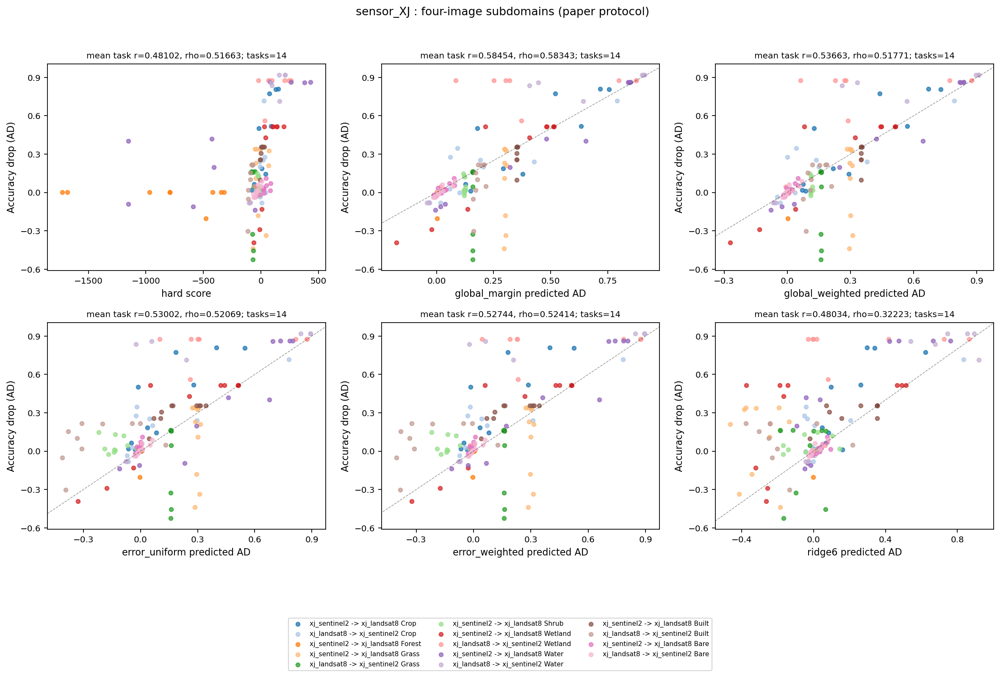

# U5 论文四图子域精度验证

## 实验目的与方法

验证：在完全不使用目标真实标签的预测阶段，能否以源域TP、FP、FN、TN的特征参考状态，结合模型分类头权重，估计目标错误概率，从而预测精度下降AD。保留FCDTM“模型权重引导特征差异”的思想；本轮只验证错误状态参考，不含后续目标混合比例拟合。

- `error_weighted`：本轮新方法；按预测前景/背景分别估计错误概率，同时使用分类间隔及到源域正确、错误原型的加权距离。
- `error_uniform`：同样的输入维度、拟合和校准流程，距离各特征维度均等权重，检验模型权重的额外贡献。
- `conditional_margin`：同样分预测前景/背景，仅使用分类间隔，不加入原型距离。
- `global_margin`、`global_weighted`：此前全局风险估计基线，分别使用分类间隔、加权特征信息；`ridge6`为此前六特征回归基线。
- `hard`：以目标硬伪标签替代真实标签计算的原FCDTM形式，仍是原生度量分数，不能直接按AD误差评价。`source_only`假设目标F1等于源F1，即预测AD为0。

没有把直接目标F1作为可部署方法，因为这会读取目标真值。评价阶段计算的真实目标F1只作为参考答案。25个模型的预测进程均通过目标标签访问审计，预测封存后才独立计算真实AD。

## 如何读图与主要结论

每个点对应固定模型、类别和迁移方向下的一个四图子域。纵轴为真实AD；除hard面板外，横轴为预测AD，虚线为理想预测线。点越靠近虚线，数值预测越准确；r和rho衡量关联及排序，不能替代误差。总览图按任务着色，图上相关系数是任务内相关的平均值，未将不同类别的点混合计算一个相关值。

新方法相较仅条件间隔的方法，将四图AD MAE从0.24316降至0.22718，但仍高于全局间隔基线的0.19686。与同容量无权重版本的0.22867非常接近，尚不能证明分类头权重具有稳定、独立的增益。大湾区跨传感器场景相关较好，跨地域较弱；即使在大湾区，全局加权基线的r也高于新方法。因此本轮支持进一步研究错误状态参考，但不支持宣称整体优于强基线。

原文N_k=4；每域40图按固定种子分10个互不重叠四图子域，每个固定任务最多10散点，共500记录。真F1和预测F1均先汇总四图计数，不是逐图F1平均。初稿单图分析保留为敏感性；本补充纠正论文口径，并非独立预注册确认，模型和参数未改。

主控制方法共同可定义相关任务50/50；每任务最多K=10，相关不保证统计稳定。源F1来自固定64图。目标标签只在四图预测再封存后的独立评价读取。

|场景|方法|共同任务|r|rho|
|---|---|---:|---:|---:|
|all|error_weighted|50|0.40858|0.43302|
|all|error_uniform|50|0.40900|0.42283|
|all|conditional_margin|50|0.41821|0.43420|
|all|global_margin|50|0.44118|0.42437|
|all|global_weighted|50|0.43807|0.44888|
|all|ridge6|50|0.29282|0.24900|
|all|hard|50|0.41938|0.42251|
|region_S2|error_weighted|14|0.19038|0.15708|
|region_S2|error_uniform|14|0.17574|0.15533|
|region_S2|conditional_margin|14|0.25990|0.25654|
|region_S2|global_margin|14|0.23354|0.19420|
|region_S2|global_weighted|14|0.26835|0.26692|
|region_S2|ridge6|14|0.17012|0.19597|
|region_S2|hard|14|0.34795|0.29912|
|region_L8|error_weighted|11|0.25582|0.40538|
|region_L8|error_uniform|11|0.27637|0.37232|
|region_L8|conditional_margin|11|0.21461|0.29959|
|region_L8|global_margin|11|0.30446|0.27756|
|region_L8|global_weighted|11|0.26259|0.35249|
|region_L8|ridge6|11|0.12413|0.18722|
|region_L8|hard|11|0.33302|0.30981|
|sensor_GBA|error_weighted|11|0.68779|0.69587|
|sensor_GBA|error_uniform|11|0.68451|0.68926|
|sensor_GBA|conditional_margin|11|0.66327|0.66501|
|sensor_GBA|global_margin|11|0.65969|0.66171|
|sensor_GBA|global_weighted|11|0.70410|0.68926|
|sensor_GBA|ridge6|11|0.37900|0.28510|
|sensor_GBA|hard|11|0.51820|0.57245|
|sensor_XJ|error_weighted|14|0.52744|0.52414|
|sensor_XJ|error_uniform|14|0.53002|0.52069|
|sensor_XJ|conditional_margin|14|0.54395|0.53628|
|sensor_XJ|global_margin|14|0.58454|0.58343|
|sensor_XJ|global_weighted|14|0.53663|0.51771|
|sensor_XJ|ridge6|14|0.48034|0.32223|
|sensor_XJ|hard|14|0.48102|0.51663|

## 四图AD数值误差

|方法|任务|MAE|
|---|---:|---:|
|error_weighted|50|0.22718|
|error_uniform|50|0.22867|
|conditional_margin|50|0.24316|
|global_margin|50|0.19686|
|global_weighted|50|0.20174|
|global_uniform|50|0.19981|
|ridge6|50|0.28336|
|source_only|50|0.37050|

## 论文式主散点图

50个单任务图见artifacts/batch4/figures/task_*.png/pdf。相关按共同点和共同任务计算，不以混类pooled相关替代任务内指标。原式hard轴为原生分数，其他为预测AD；负AD保留。常量或不足3点N/A，不记0。

预测与分组来自冻结无标签缓存和固定图名随机种子，未读真值参与聚合。论文图式沿用，但本轮不是FD/DS/GBC完整复现，历史池未变独立区域。

## 与原假设的对照判断

|方法|共同任务r|共同任务rho|四图AD MAE|
|---|---:|---:|---:|
|hard|0.41938|0.42251|无AD单位|
|error_weighted|0.40858|0.43302|0.22718|
|error_uniform|0.40900|0.42283|0.22867|
|conditional_margin|0.41821|0.43420|0.24316|
|global_margin|0.44118|0.42437|0.19686|
|global_weighted|0.43807|0.44888|0.20174|
|ridge6|0.29282|0.24900|0.28336|

源错误状态加权相对条件margin的误差下降，不等于超过原U2或证明头权重必需。对照同容量无权重、全局margin和ridge6后综合判断，不能以单图更高的相关替代原论文四图口径。当前缺乏稳定超过强基线的整体证据，混合比例估计阶段不在本次运行范围。

四图分组和概率汇总已再次封存；相关统计独立重算通过，所有模型共用同一固定分组。先前单图程序自动完成后才发现N_k=4的核对遗漏，补充协议透明记录时序；没有改变任何模型或概率参数，不声称独立盲法或完全预注册确认。
