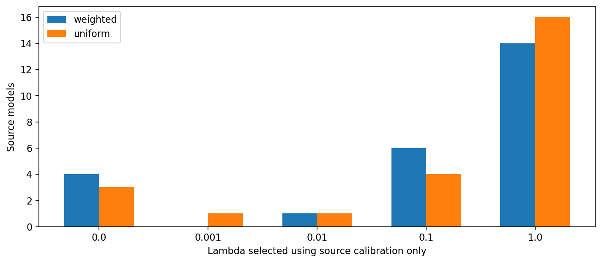
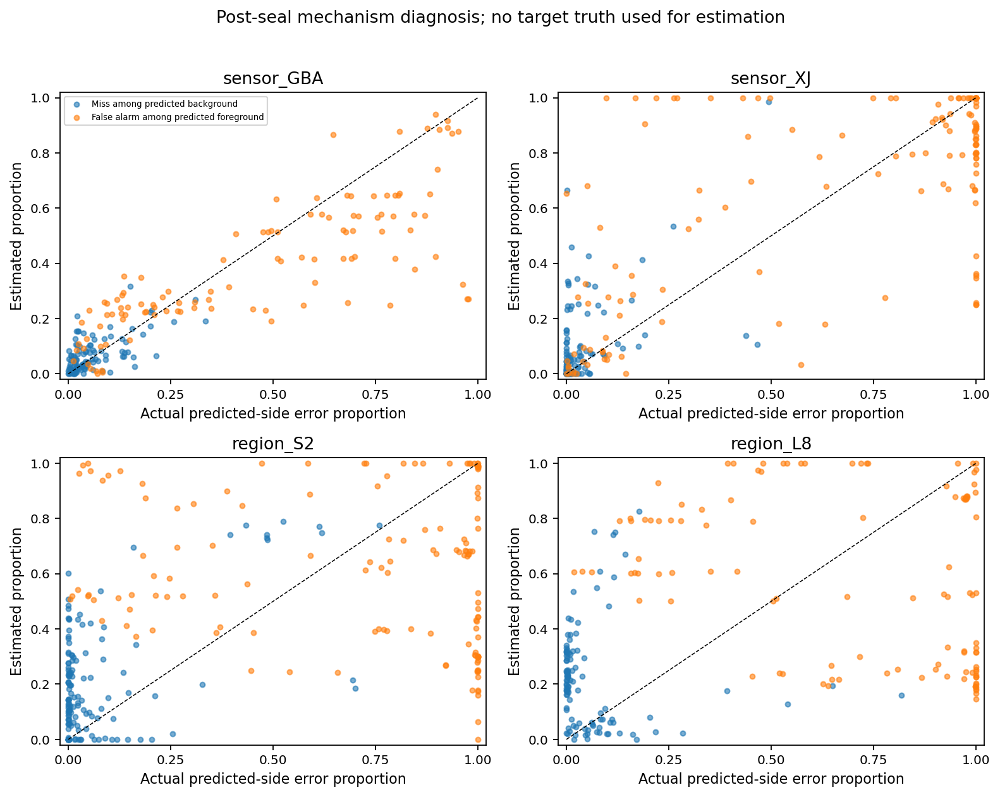

# U6 实验结果分析

## 要验证什么

U5将源域错误后验直接用于目标，跨地域出现乐观偏差。U6保留模型权重引导特征距离和源域错误状态参考，在目标无标签分布上拟合正确/错误的混合比例。检验这种比例更新能否减少精度下降预测误差，同时保持跨传感器表现和选模价值。

本轮25个冻结UNet、8类、50迁移任务，源64图/目标40图，与U5配对。主验证每4图一个子域、每任务10点，共500记录。附加800个8/16/24/40图无标签池预测。不是目标标注预算，也不是未见网格确认。

预测进程25个原生文件访问审计全部通过后封存；独立最小二乘重算5200个混合预测通过，才读取目标真标签评价。没有目标微调、目标真标签校准或事后调lambda。

## 主要四图结果

下表在主六面板共同有限点上，按任务等权，相关再使用共同可定义任务。MAE=|预测AD-真实AD|=|预测F1-真实F1|；F1正偏差表示高估目标精度。源域F1固定，AD=源F1-目标F1。

|方法|有效点/500|AD MAE↓|F1偏差|平均r↑|平均rho↑|
|---|---:|---:|---:|---:|---:|
|mix_weighted|495|0.24386|0.08023|0.33599|0.30701|
|mix_uniform|495|0.24029|0.07095|0.34754|0.33758|
|mix_weighted_raw|495|0.24476|0.01005|0.33436|0.34458|
|mix_uniform_raw|495|0.23550|-0.01723|0.33425|0.32151|
|U5_weighted|495|0.22723|0.13611|0.40573|0.43554|
|global_margin|495|0.19691|0.04592|0.43956|0.42673|
|global_weighted|495|0.20179|0.07012|0.43549|0.45173|
|ridge6|495|0.28341|0.18342|0.29192|0.25099|
|source_only|495|0.37055|0.27377|N/A|N/A|

六面板共同可定义相关任务：49/50。各方法自身有效点与共同点结果分别保存在误差与偏差.csv，N/A不补0。source_only为常量AD，相关不可定义。硬/软伪标签原式和confidence的原生分数相关保存在CSV，不给它们虚构AD数值误差。

## 分场景判断

|场景|方法|点数|MAE↓|F1偏差|
|---|---|---:|---:|---:|
|sensor_GBA|U5_weighted|110|0.10571|0.05131|
|sensor_GBA|mix_weighted|110|0.13143|0.07788|
|sensor_GBA|mix_uniform|110|0.13008|0.09405|
|sensor_GBA|mix_weighted_raw|110|0.24354|-0.07442|
|sensor_GBA|mix_uniform_raw|110|0.24465|-0.09991|
|sensor_GBA|global_margin|110|0.08546|-0.00977|
|sensor_GBA|global_weighted|110|0.07921|0.03000|
|sensor_GBA|ridge6|110|0.14205|0.11139|
|sensor_XJ|U5_weighted|137|0.16689|0.08969|
|sensor_XJ|mix_weighted|137|0.16374|0.00689|
|sensor_XJ|mix_uniform|137|0.16222|0.01021|
|sensor_XJ|mix_weighted_raw|137|0.21870|0.00801|
|sensor_XJ|mix_uniform_raw|137|0.20993|-0.00057|
|sensor_XJ|global_margin|137|0.11647|-0.02608|
|sensor_XJ|global_weighted|137|0.11694|-0.00004|
|sensor_XJ|ridge6|137|0.20499|0.15320|
|region_S2|U5_weighted|138|0.33075|0.16538|
|region_S2|mix_weighted|138|0.32862|0.11165|
|region_S2|mix_uniform|138|0.32091|0.06672|
|region_S2|mix_weighted_raw|138|0.25618|0.04507|
|region_S2|mix_uniform_raw|138|0.25985|0.01220|
|region_S2|global_margin|138|0.30954|0.08678|
|region_S2|global_weighted|138|0.32470|0.10057|
|region_S2|ridge6|138|0.40569|0.22851|
|region_L8|U5_weighted|110|0.29381|0.24276|
|region_L8|mix_weighted|110|0.35037|0.13592|
|region_L8|mix_uniform|110|0.34726|0.13057|
|region_L8|mix_weighted_raw|110|0.26463|0.05254|
|region_L8|mix_uniform_raw|110|0.22792|0.00678|
|region_L8|global_margin|110|0.26738|0.14124|
|region_L8|global_weighted|110|0.27595|0.16077|
|region_L8|ridge6|110|0.36895|0.23653|

### 预设假设的检验

混合加权相对U5的总体四图MAE变化（负为改善）：0.01662；相对同容量无权重：0.00357；相对全局间隔：0.04695。
- sensor_GBA：相对U5 MAE变化0.02572，F1偏差由0.05131变为0.07788。
- sensor_XJ：相对U5 MAE变化-0.00315，F1偏差由0.08969变为0.00689。
- region_S2：相对U5 MAE变化-0.00213，F1偏差由0.16538变为0.11165。
- region_L8：相对U5 MAE变化0.05656，F1偏差由0.24276变为0.13592。

不能由局部相关或一个类别的改善推断整体胜出；lambda=0版本用于诊断源域校准是否过度收缩，不据其目标结果重新选lambda。不同方法若有效点不一致，优先查看共同点和覆盖率。

## 8/16/24无标签影像预算与模型选择

误差按源模型—迁移任务等权，选择按类别—目标域等权、预算等权。重复子池共用影像，不是独立实验。候选模型与U5完全相同，方法不可算时整次配置记不可算，不删候选。选择可能同时涉及跨传感器和跨地域候选，不将其硬拆为单一场景。

|方法|AD MAE↓|共同可选配置/全部|平均遗憾↓|Top-1↑|最大损失↓|
|---|---:|---:|---:|---:|---:|
|mix_weighted|0.24292|300/300|0.06984|0.59667|0.68078|
|mix_uniform|0.23924|300/300|0.06648|0.63667|0.68078|
|mix_weighted_raw|0.26222|300/300|0.06357|0.58000|0.66604|
|mix_uniform_raw|0.24756|300/300|0.06480|0.58667|0.66604|
|U5_weighted|0.22358|300/300|0.04027|0.70000|0.50816|
|global_margin|0.19040|300/300|0.03500|0.72000|0.50816|
|global_weighted|0.19496|300/300|0.03804|0.71667|0.50816|
|ridge6|0.24647|300/300|0.02334|0.74000|0.50816|
|source_only|0.31174|300/300|0.06230|0.61333|0.50816|

原生分数对照、自身覆盖、分预算见选择汇总.csv；分类别误差见分类别误差.csv。相同F1预测并不保证相同选模表现，不能用任务内散点相关代替选模实验。

## 源域校准与参考支持

lambda仅从[0,0.001,0.01,0.1,1]按源cal伪目标F1 MAE选择；原型、尺度、8箱分位点、0.5伪计数、100次空间块bootstrap均在目标评价前固定。

- weighted的25模型lambda计数：{0.0: 4, 0.01: 1, 0.1: 6, 1.0: 14}。
- uniform的25模型lambda计数：{0.0: 3, 0.001: 1, 0.01: 1, 0.1: 4, 1.0: 16}。

源fit/cal/test名单、直方图及每模型lambda候选损失见artifacts/source。内部test只是度量器检查；源64图历史上参与过模型选优，不能称分割网络独立OOF。

## 机制诊断：比例更新是否足够

TV残差是目标直方图与拟合混合参考的差异；参考分离度小表示比例难估。超过源cal残差95分位仅表示参考解释能力不足，不直接等同于高错误率。

|场景|加权参考条件漂移TV|背景侧比例MAE|前景侧比例MAE|F1 bootstrap宽度|经验覆盖率|
|---|---:|---:|---:|---:|---:|
|all|0.28755|0.12462|0.29450|0.37052|0.50403|
|sensor_GBA|0.20480|0.03948|0.14168|0.28822|0.58182|
|sensor_XJ|0.21550|0.06817|0.20168|0.45849|0.68841|
|region_S2|0.33755|0.17267|0.38852|0.41310|0.44928|
|region_L8|0.39674|0.22045|0.44498|0.28705|0.26364|

条件漂移诊断使用封存后才读取的目标真值和每图固定512个采样像素，只用于解释失败，绝不作为部署输入。不同场景可用错误状态支持不同，缺失状态不记0。漂移TV包含采样误差，不能单独证明因果机制。bootstrap按空间行块重采样；四图子域可能只有少量块，区间是描述性的，不保证真值覆盖。

## 图表与读图

主六面板横轴为预测AD，纵轴为真实AD，虚线是1:1；各任务颜色一致，相关按任务内计算后平均。每个点汇总4图计数。各方法同一有效点，保留负AD。

50组逐任务六面板见[图表索引](图表索引.md)，全部PNG/PDF。

## 范围与限制

本轮沿用已见开发池，不能证明对独立区域有效；U4需先做训练角色/空间重叠审计。直方图采用边缘分布，未建模完整联合分布；单个正确/错误参考仍可能多峰、稀缺，跨地域参考状态本身会漂移。分布混合假设被破坏时，仅调整比例无法保证识别真实错误。所有结果包括失败项一并保留；没有看目标真值再调参数。保留模型权重并不自动证明其贡献，必须通过同容量无权重消融。

## 最终判读与后续方向（评价后解释，不改预测）

**本轮未达到预设的整体改进目标，不建议用U6替换U5或现有强基线。** 在495个共同有效四图点上，加权混合MAE为0.24386，U5为0.22723，全局间隔为0.19691；同容量无权重混合为0.24029。8/16/24池选择遗憾由U5的0.04027升至0.06984，Top-1由0.70000降至0.59667，最大损失由0.50816升至0.68078。权重本身没有显示稳定独立贡献。

### 1. 降低平均乐观偏差，并不等于预测更准

加权混合总体F1偏差从U5的+0.13611降至+0.08023，但绝对误差上升。L8跨地域尤其明显：偏差从+0.24276降至+0.13592，MAE却从0.29381升至0.35037。说明部分过于乐观的预测被修正，同时其他任务产生较大反向误差或波动；正负误差抵消后的平均偏差不能代替MAE。

### 2. 源域收缩选择与目标漂移强度之间有矛盾

不收缩的加权版本在S2/L8跨地域MAE分别为0.25618/0.26463，低于U5的0.33075/0.29381；但大湾区/新疆跨传感器MAE升至0.24354/0.21870，U5为0.10571/0.16689。源校准选lambda的版本缓解部分跨传感器损失，却不能兼顾跨地域。无权重不收缩版本在L8跨地域为0.22792，比加权版本更低。因此不能事后用场景真值选开关，也不能把这两个局部改善写成已解决跨地域问题。

### 3. 证据更支持“参考状态漂移也重要”，而不只是混合比例变化

封存后的加权特征条件漂移TV：大湾区/新疆跨传感器约0.205/0.215，S2/L8跨地域约0.338/0.397。L8跨地域预测前景侧混合残差超过源cal 95分位的比例约79.1%，大湾区跨传感器约26.4%。这与跨地域源参考解释能力下降相符，但状态稀缺、采样和任务组成同样影响TV，仍不能视为单一因果证明。

仅用源/目标空间块bootstrap得到的名义95%百分位区间，总体经验覆盖只有约50.4%，L8跨地域约26.4%。这些区间描述采样波动，未覆盖参考分布失配导致的偏差，不能用于声称可靠性保障或安全选模。

### 4. 下一步值得验证的方向

先保持主方法不变，不在当前目标真值上继续选lambda。优先构造源域空间留出和预设扰动下的多组正确/错误参考，检查是否能覆盖目标出现的状态变化；扰动强度与收缩选择只用源域训练/校准，另留源域伪迁移任务验证。与单参考及同容量无权重成对比较，确认收益来自参考覆盖还是模型权重。只有源域伪迁移能稳定改进且未损害强基线后，再固定公式到完成训练角色/空间重叠审计的新网格确认。光谱扰动不等于真实跨地域语义变化，不能预先保证成功。

### 覆盖与复核

主表为六种主面板方法共同可计算点；四图真值自身不可定义项、方法不可定义项分别保留，详见逐项评价与误差覆盖CSV。相关共同可定义主任务49/50；不收缩版本在其中各有47个可定义相关任务，因此不能把它们的相关均值直接当成与主面板完全同任务对比。source_only为常量AD，相关N/A。所有300个8/16/24多候选配置均可计算，没有删候选。

独立复核通过：1300评价记录、2000项U5四图基线标量完全一致、1200项相关与540项误差汇总重算、58对PNG/PDF，预测哈希与评价代码冻结哈希保持一致。未更改U5、目标标签角色或模型参数。

500个四图记录中，4个真实F1分母为0；另1个新疆S2→L8森林子域（编号9）真实F1=0，但混合方法估计无前景且无错误，预测F1分母为0，故共同有效495点。该失败记录原样保留，不补0。加权25个模型中14个源校准选择lambda=1，无权重16个，说明源cal通常偏好强收缩；此观察不用于本轮目标调参。
