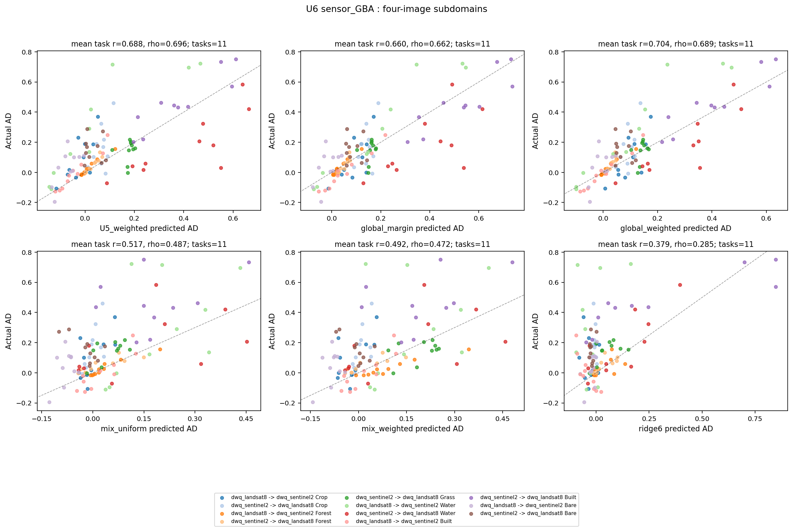
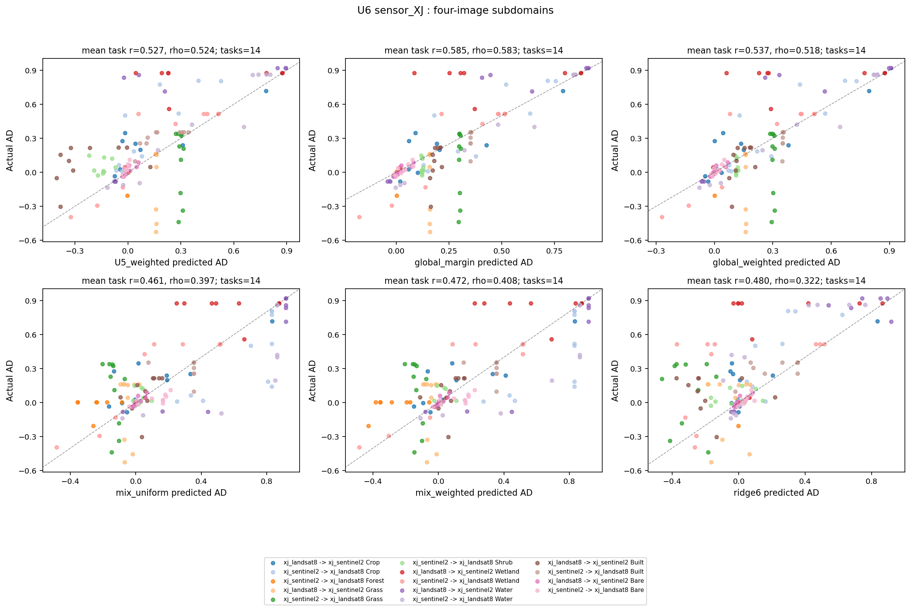
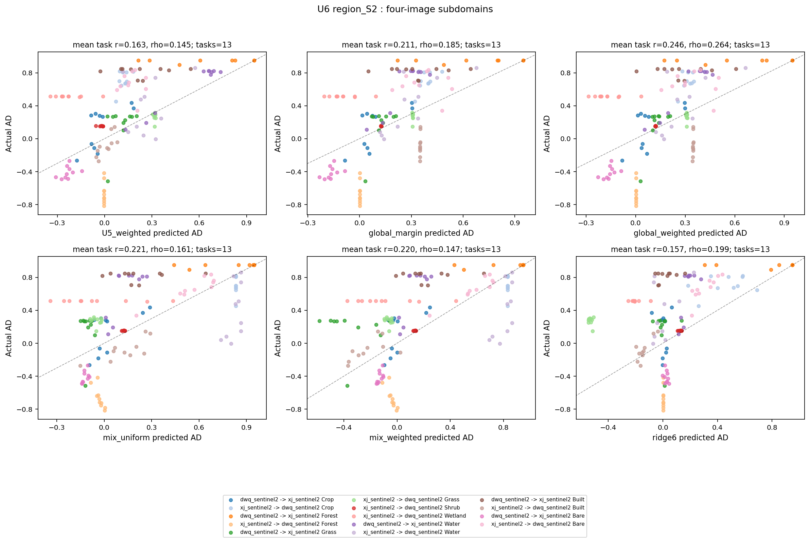
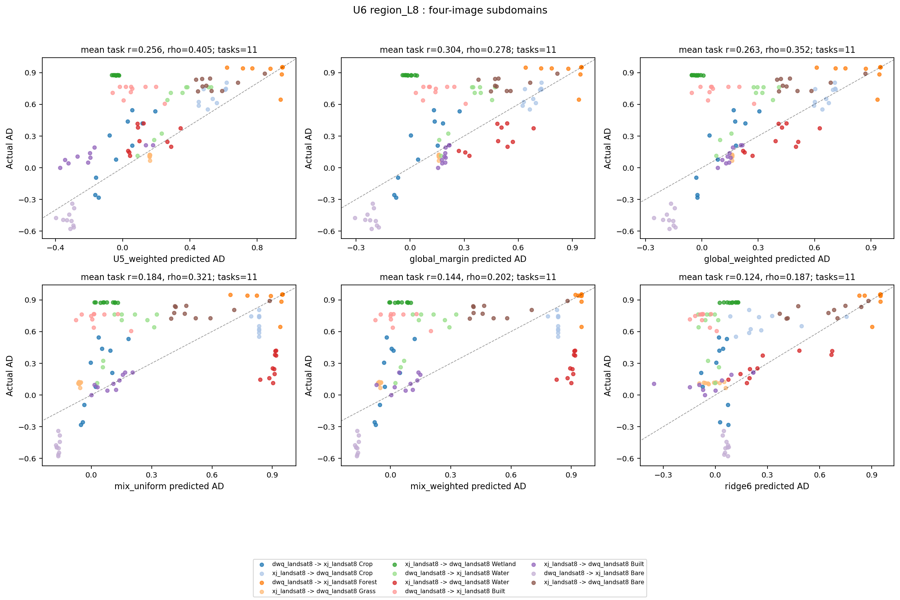
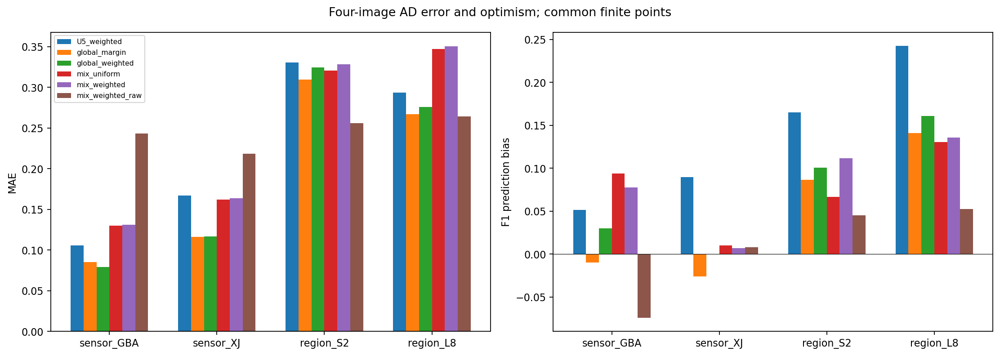
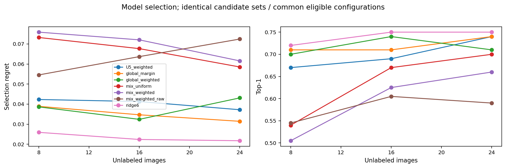

# U6 实验结果分析：重新估计目标错误比例，能否比U5更准？

> 本报告用通俗语言整理实验目的、方法和结果。原始预测、参数、数字及图表均未改变。详细结果表保留在附录，方法代码名与图表、CSV一致。

## 1. 先看结论

**U6没有达到预设的整体改进目标，目前不建议用它替换U5或已有的较强对照方法。**

U6确实减轻了部分“把目标F1估得太高”的问题，但总体预测误差反而增大，选模型的表现也变差。完全放开调整，能改善部分跨地域任务，却明显损害跨传感器任务。加权版本也没有稳定优于无权重版本。

这轮实验带来的重要认识是：**迁移后，可能不只是“错误样本多了或少了”，连“错误样本长什么样”也变了。只重新估计数量比例，可能解决不了参考本身不适用的问题。** 这是与诊断结果相符的解释，还不能当作已经证明的唯一原因。

## 2. 为什么要从U5继续做U6？

以水体识别为例，模型在源域可能很少把陆地认成水体。但到了另一地区，新地物、新背景可能让这种错误变多。

U5先在有标签的源域中学习“哪些特征容易判断正确、哪些容易出错”，然后用这套关系估计目标表现。它在跨地域任务中经常过于乐观，也就是高估目标F1、低估精度下降。

因此，U6提出一个问题：

> **源域里的正确／错误参考先保留，但允许目标域中正确样本和错误样本的比例发生变化，预测会不会更准？**

它仍然保留FCDTM“用模型权重决定哪些特征更重要，再比较特征分布”的思想。候选UNet不训练、不微调，评估算法也不看目标真实标签。

## 3. U6的方法怎样理解？

可以把源域样本想成两堆积木：一堆是“模型判断正确的样本”，另一堆是“模型判断错误的样本”。我们已经知道两堆积木各自的大致特征。

到了目标域，只看得到混在一起的一堆特征，看不到真实标签。U6尝试调整两堆参考的混合比例，看看哪种比例最像目标数据。

实际计算时，分别处理两个预测侧：

|目标像素被模型预测为……|U6要估计什么？|
|---|---|
|水体，即当前地物的“前景”|这些像素中，有多少可能其实不是水体，也就是误报？|
|非水体，即“背景”|这些像素中，有多少可能其实是水体，也就是漏检？|

特征分布用直方图表示，可以理解成把特征值分段后，统计各段有多少像素。U6调整正确／错误参考的混合比例，让混合后的直方图尽量接近目标直方图。

之后，用估计的误报、漏检和正确识别数量计算预测F1，再计算精度下降AD。**“预测为水体”只是模型的判断，不被当作真实答案。**

这个方法有一个关键前提：目标中的正确、错误样本，特征仍然能被源域参考大致解释。如果两地的错误样本本身很不一样，调整比例也可能配不出目标分布。

## 4. “收缩”和“不收缩”是什么意思？

直接按目标直方图拟合比例，可能受少量影像或参考不足影响，得到很极端的结果，例如认为几乎全对或全错。

所以U6设置了一个“拉回源域常见错误比例”的约束，称为**收缩**。强度用lambda表示：

- lambda越大，估计越不容易偏离源域常见比例；
- lambda为0，不加这个约束，更多依赖目标分布拟合结果。

lambda从固定的五个候选值中选择，选择依据只来自源域校准数据。这里的“校准”，是调整评估算法，不是微调UNet，更没有使用目标标签。

同时保留不收缩版本，是为了检查：源域校准是否把估计拉回得太多。**不能在看完目标答案后，给不同场景分别挑更好的版本。** 那样就不再是无目标标签的预测验证。

## 5. 表中的方法都是什么？

|代码名|中文解释|
|---|---|
|`mix_weighted`|U6主方法：使用模型权重比较特征分布，并用源域数据选择收缩强度|
|`mix_uniform`|U6无权重对照：同样的流程，但各特征维度同等重要|
|`mix_weighted_raw`|U6加权、不收缩版本，即lambda固定为0|
|`mix_uniform_raw`|U6无权重、不收缩版本|
|`U5_weighted`|上一轮U5新方法，不重新拟合目标错误比例|
|`global_margin`|源域校准的分类间隔方法：只根据两类输出分数之差，估计像素类别概率，再汇总预测F1|
|`global_weighted`|此前使用加权特征信息估计像素类别概率的对照方法|
|`ridge6`|根据六种预测统计信息，回归估计正确识别、漏检数量的简单方法|
|`source_only`|直接假设目标F1等于源域F1，即没有精度下降|

这里`raw`只表示U6“不收缩”，**不是原论文FCDTM**。原FCDTM硬／软伪标签分数以及模型自信程度`confidence`也保留在CSV中；它们没有直接的AD单位，不为其虚构AD预测误差。

## 6. 实验怎样保证公平？

U6与U5使用相同的25个已训练模型、8种地物类别和50个迁移任务。一个任务指固定模型、类别和迁移方向，例如“大湾区S2水体模型用于大湾区L8”。

每个模型使用64张源域参考图，每个目标域使用40张无标签图。按照原论文的验证方式，把目标40张图固定分成10组，每组4张，因此一共得到500条四图记录。预测和真实F1都先汇总4张图的计数，再计算，不能平均逐图F1。

另外，使用相同的8、16、24张目标影像预算，各抽取5次，并保留40张完整图池结果，共800条池预测。**这些预算是无标签影像数量，不是目标标注数量。**

所有预测先保存、封存，并通过独立复算，再由单独程序读取目标真标签“核对答案”。25个预测进程的文件访问审计全部通过；5200个混合预测数值也由另一种求解方式独立复算通过。没有依据目标答案重选lambda或改公式。

本轮仍沿用U5历史开发数据，适合做配对比较，不能当作未参与设计的新区域确认。

## 7. 预测精度下降，U6比U5准了吗？

先解释两个容易混淆的指标。

**AD是精度下降量：AD = 源域F1 − 目标F1。** 例如源F1为0.85，目标F1为0.65，AD就是0.20，即下降20个F1百分点。

**MAE看预测差了多少，越小越好。** 它是预测AD与真实AD的绝对差，等价于预测目标F1与真实目标F1的绝对差。先在每个任务内平均，再对任务等权平均。

**F1偏差看平均偏向哪边，越接近0越好。** 本报告按“预测目标F1−真实目标F1”计算。正数表示过于乐观，负数表示过于悲观；正负误差会互相抵消。

在各主方法共同可计算的495个四图记录上，结果如下。

|方法|AD平均绝对误差MAE↓|F1平均偏差|
|---|---:|---:|
|U5|0.22723|+0.13611|
|U6加权，主方法|0.24386|+0.08023|
|U6无权重|0.24029|+0.07095|
|U6加权、不收缩|0.24476|+0.01005|
|U6无权重、不收缩|0.23550|−0.01723|
|源域校准的分类间隔对照|**0.19691**|+0.04592|

**U6主方法总体没有更准。** MAE从0.22723升到0.24386，相当于平均绝对误差增加约1.7个F1百分点。它也没有超过无权重版本或简单的分类间隔对照。

虽然U6减少了平均乐观偏差，但不能据此宣布成功。例如，一种预测每次都高估0.20，平均偏差和MAE都是0.20；另一种一次高估0.50、一次低估0.50，平均偏差为0，但MAE却是0.50。后者“平均不偏”，实际反而更不准。

U6不收缩版本的偏差接近0、MAE仍较大，也说明了这一点。偏差与绝对误差需要一起看。

## 8. 哪些场景改善，哪些退步？

S2指Sentinel-2，L8指Landsat 8。跨传感器是在同一区域更换传感器；跨地域是在大湾区与新疆之间迁移、保持传感器相同。

下表只列预测误差，越小越好。U6“不收缩”仍使用模型权重。

|场景|U5|U6主方法|U6不收缩|U6主方法相对U5|
|---|---:|---:|---:|---|
|大湾区跨传感器|0.10571|0.13143|0.24354|变差|
|新疆跨传感器|0.16689|0.16374|0.21870|小幅改善|
|S2跨地域|0.33075|0.32862|0.25618|小幅改善|
|L8跨地域|0.29381|0.35037|0.26463|明显变差|

完全放开比例调整，在两个跨地域场景中比U5更准；但在跨传感器场景中明显变差。源域校准选出的约束，缓解了一些损失，却没有同时照顾好两类迁移。

L8跨地域还出现一个很直观的现象：U6主方法的F1高估从约24.3个百分点降到约13.6个百分点，但MAE却从0.29381升到0.35037。**纠正平均乐观倾向，不等于每个任务都被纠正得更准确。**

无权重、不收缩版本在L8跨地域的误差为0.22792，低于加权、不收缩的0.26463。因此，这个局部改善也不能作为模型权重有优势的证据。

## 9. 真正用来选候选模型，效果怎样？

预测每个模型的具体F1，与选出最好的候选，是两种不同能力，需要分别评价。

- **选择遗憾**：本次最优候选的真实F1减去选中模型的真实F1。例如最优0.80、选中0.75，遗憾就是0.05。越小越好。
- **Top-1**：选中最优候选的比例，越大越好。遇到并列按固定规则分摊。
- **最大损失**：所有配置中最严重一次选错损失了多少F1，越小越好。

以下按8、16、24张无标签影像预算等权汇总，全部300个多候选配置均可计算，没有删除候选。

|方法|平均选择遗憾↓|Top-1↑|最大损失↓|
|---|---:|---:|---:|
|U5|0.04027|70.0%|0.50816|
|U6主方法|0.06984|59.7%|0.68078|
|U6无权重|0.06648|63.7%|0.68078|
|U6加权、不收缩|0.06357|58.0%|0.66604|
|源域校准的分类间隔对照|0.03500|72.0%|0.50816|
|六统计量回归|**0.02334**|**74.0%**|0.50816|

U6主方法选中模型距离本次最优候选的F1，平均差约7.0个百分点，U5约4.0个百分点。最严重一次损失约68.1个百分点，也比U5更大。

因此，U6在本轮中既没有保住U5的选模表现，也没有超过已有对照。不收缩版本即使在部分跨地域任务中预测更准，也没有转化为整体更好的选模结果。

同一目标域的候选可能同时来自不同传感器、不同地区，不能简单把这个选模汇总归为单一迁移场景。重复抽图共用数据，也不是300个完全独立的实验。

## 10. 为什么只调比例可能不够？诊断发现了什么？

U6的基本假设是：“源域正确／错误样本的特征仍适用，只是它们在目标域中的比例变了。”

为了检查这个假设，所有预测封存后，我们才用目标标签把目标样本也分为正确／错误组，比较这些组与源域参考的特征分布。**这一步只用于解释实验，目标真值没有进入实际预测。**

### 10.1 跨地域的参考变化更大

这里用TV衡量两组特征分布的差别。可以把它理解成“直方图有多不一样”，数值越大，差别越大。它不是错误率，也不是F1。

|场景|正确／错误参考的分布差异TV|
|---|---:|
|大湾区跨传感器|0.20480|
|新疆跨传感器|0.21550|
|S2跨地域|0.33755|
|L8跨地域|0.39674|

跨地域的差别更大，与“原参考不再充分适用”的解释一致。可以类比：源域错误主要来自水体边缘，目标域错误却主要来自把阴影认成水体；即使都叫“误报”，两类错误的特征也可能不同。这个例子用于解释机制，并不是本实验已经识别出的具体错误类型。

但TV也受样本稀缺、采样误差和任务组成影响，这张表不能单独证明因果关系。

### 10.2 目标分布经常无法被源参考很好地拼出来

还可以看“调整比例后，混合直方图与目标直方图仍差多少”，称为拟合残差。它与上一节分组后的参考差异不是同一个指标。

以预测前景侧为例，L8跨地域约79.1%的图组，其拟合残差超过源域校准数据的95%分位；大湾区跨传感器约为26.4%。这表明不少跨地域图组比源域校准时更难解释。

**残差大只说明参考可能不合适，不能直接翻译成“模型错误率很高”。**

### 10.3 当前不确定性范围也不够可靠

我们按空间块重复重采样100次，得到预测F1的一个百分位范围，也就是代码中的bootstrap区间。它主要反映换一批源／目标空间块时，预测会怎样波动。

虽然取的是重采样结果中间95%的范围，真实F1实际落在范围内的比例，总体只有约50.4%，L8跨地域约26.4%。因此不能把它宣传为已经可靠校准的“95%保证”。

这提示重采样波动不能充分反映参考分布不适用造成的系统误差；同时，每个四图组可能只有少数空间块，区间本身也有局限。当前不宜直接用这个区间做可靠性保障或选模开关。

## 11. 模型权重到底有没有帮助？

本轮主方法加权MAE为0.24386，无权重为0.24029；加权Top-1为59.7%，无权重为63.7%。这些结果没有支持“保留模型权重就一定更好”。

这并不等于已经证明原论文思想在任何情况下都无效。更准确的结论是：**在U6这套表示、源参考和比例拟合方式下，没有看到稳定的权重增益。** 如果今后改进，需要同时保留同容量无权重对照，验证增益究竟来自哪里。

## 12. 散点图和其他图表怎么看？

主散点图每个点对应固定模型在4张目标图上的结果。横轴为预测AD，纵轴为真实AD，虚线为理想预测线。

- 越接近虚线，预测的具体数值越准。
- 在虚线上方，说明实际下降比预测多，方法过于乐观。
- 在虚线下方，说明实际下降比预测少，方法过于悲观。
- AD为负表示目标这组图上表现反而更好，不能强行改成0。

图上r主要看预测与真实下降是否一起变化，rho主要看变化顺序。它们在每个固定任务内部计算，再取平均。**这是同一模型在不同图组上的排序，不等于候选模型的筛选能力。** 高相关也不代表接近虚线，需同时看MAE。

### 大湾区跨传感器

### 新疆跨传感器

### S2跨地域

### L8跨地域

### 分场景误差与偏差

左图的柱子越低，预测越准；右图越接近0，平均偏向越小。两图必须一起看。

### 不同影像数量下的选模结果

左图选择遗憾越低越好；右图Top-1越高越好。横轴是无标签目标影像数量。

### 源域选出的收缩强度

加权25个模型中14个选择lambda=1，无权重16个，说明源域校准经常偏好强收缩。但“在源域校准时更好”，不保证到了另一地区仍然更好。

### 错误比例估计是否准确

横轴是真实的预测侧错误比例，纵轴是估计比例，越接近虚线越好。这里的真实比例只在封存后用于核对。前景侧误报比例，以预测前景像素数为分母；背景侧漏检比例，以预测背景像素数为分母，不能直接混称常规FPR、FNR。

其余50组逐任务图及PDF见[图表索引](图表索引.md)，全部共58组PNG/PDF。

## 13. 为什么500条记录只比较495条？

不是所有F1都能正常计算。

500个四图记录中，4个真实F1的分母为0，因此真实F1记为N/A。另有1个新疆S2→L8森林任务的子域（编号9），真实F1为0，但混合方法估计没有前景、也没有错误，使预测F1的分母也变成0。它也是一次失败记录，被原样保留，没有补0或删除痕迹。

因此主表使用各主方法共同能计算的495条记录。U5报告中某些数字与这里略有不同，是因为这里重新对齐了U6共同有效点和任务，并不是重新跑出了另一套U5预测。U5四图对照的2000项标量已核对一致。

主面板的相关在49个共同可定义任务上汇总。不收缩版本在其中只有47个任务的相关可定义，不能把它们的相关均值当成完全同任务的公平比较。`source_only`预测AD始终为0，没有变化，相关记N/A。

四图验证的缺失项不影响8／16／24图选模实验中全部300个配置可计算的事实。更多覆盖信息见CSV，不把N/A当成0，也不通过删除候选让结果变好。

## 14. 下一步更值得做什么？

本轮不支持继续在当前目标答案上反复挑lambda，也不支持直接用“跨地域选不收缩、跨传感器选收缩”的事后规则作为成功方法。

更值得验证的是：**先让源域参考覆盖更多可能的正确和错误状态，再估计目标比例。**

可以在源域做空间留出、加入预先规定的影像扰动，建立多组正确／错误参考。扰动强度、收缩选择和其他参数仍只用源域数据确定，另留源域伪迁移任务检查。随后与单参考、同容量无权重及简单强对照比较，确认是否有稳定改善。

如果源域检查有稳定收益，再固定公式，到完成模型训练角色和空间重叠核查的新网格验证。源域光谱扰动不能代表所有真实跨地域变化，所以这只是值得测试的方向，不是已经得到验证的解决方案。

## 15. 结果能支持什么，不能支持什么？

可以支持：U6揭示了只更新目标错误比例的局限，提供了参考状态漂移的诊断线索，所有失败结果均保留。

不能支持：U6整体优于U5或简单对照、模型权重已经证明有效、bootstrap区间已有可靠保障，或方法已经通过独立新区域验证。

本轮历史开发池不独立；源64张图过去参与过模型选优，内部再分拟合、校准、检查部分，也不等于给UNet提供全新的独立验证集。重复图组和候选模型相互关联，不能把所有记录当作独立样本。

技术上，本轮只用少量特征的边缘直方图，没有完整刻画所有特征的联合变化；正确／错误参考也可能包含多种形态，某些状态的源样本较少。以上限制都可能影响结果。没有根据目标真值重新调参，U5和模型参数保持原样。

## 附录A：完整四图主结果

代码名的中文解释见第5节。r和rho看关联及任务内顺序，不代替数值误差或选模。每个方法自身有效点与共同点结果保存在`artifacts/误差与偏差.csv`。

|方法|有效点/500|AD MAE↓|F1偏差|平均r↑|平均rho↑|
|---|---:|---:|---:|---:|---:|
|mix_weighted|495|0.24386|0.08023|0.33599|0.30701|
|mix_uniform|495|0.24029|0.07095|0.34754|0.33758|
|mix_weighted_raw|495|0.24476|0.01005|0.33436|0.34458|
|mix_uniform_raw|495|0.23550|-0.01723|0.33425|0.32151|
|U5_weighted|495|0.22723|0.13611|0.40573|0.43554|
|global_margin|495|0.19691|0.04592|0.43956|0.42673|
|global_weighted|495|0.20179|0.07012|0.43549|0.45173|
|ridge6|495|0.28341|0.18342|0.29192|0.25099|
|source_only|495|0.37055|0.27377|N/A|N/A|

## 附录B：完整分场景结果

场景代码：`sensor_GBA`=大湾区跨传感器；`sensor_XJ`=新疆跨传感器；`region_S2`=S2跨地域；`region_L8`=L8跨地域。F1偏差为正表示高估目标F1，为负表示低估。

|场景|方法|点数|MAE↓|F1偏差|
|---|---|---:|---:|---:|
|sensor_GBA|U5_weighted|110|0.10571|0.05131|
|sensor_GBA|mix_weighted|110|0.13143|0.07788|
|sensor_GBA|mix_uniform|110|0.13008|0.09405|
|sensor_GBA|mix_weighted_raw|110|0.24354|-0.07442|
|sensor_GBA|mix_uniform_raw|110|0.24465|-0.09991|
|sensor_GBA|global_margin|110|0.08546|-0.00977|
|sensor_GBA|global_weighted|110|0.07921|0.03000|
|sensor_GBA|ridge6|110|0.14205|0.11139|
|sensor_XJ|U5_weighted|137|0.16689|0.08969|
|sensor_XJ|mix_weighted|137|0.16374|0.00689|
|sensor_XJ|mix_uniform|137|0.16222|0.01021|
|sensor_XJ|mix_weighted_raw|137|0.21870|0.00801|
|sensor_XJ|mix_uniform_raw|137|0.20993|-0.00057|
|sensor_XJ|global_margin|137|0.11647|-0.02608|
|sensor_XJ|global_weighted|137|0.11694|-0.00004|
|sensor_XJ|ridge6|137|0.20499|0.15320|
|region_S2|U5_weighted|138|0.33075|0.16538|
|region_S2|mix_weighted|138|0.32862|0.11165|
|region_S2|mix_uniform|138|0.32091|0.06672|
|region_S2|mix_weighted_raw|138|0.25618|0.04507|
|region_S2|mix_uniform_raw|138|0.25985|0.01220|
|region_S2|global_margin|138|0.30954|0.08678|
|region_S2|global_weighted|138|0.32470|0.10057|
|region_S2|ridge6|138|0.40569|0.22851|
|region_L8|U5_weighted|110|0.29381|0.24276|
|region_L8|mix_weighted|110|0.35037|0.13592|
|region_L8|mix_uniform|110|0.34726|0.13057|
|region_L8|mix_weighted_raw|110|0.26463|0.05254|
|region_L8|mix_uniform_raw|110|0.22792|0.00678|
|region_L8|global_margin|110|0.26738|0.14124|
|region_L8|global_weighted|110|0.27595|0.16077|
|region_L8|ridge6|110|0.36895|0.23653|

## 附录C：8／16／24图预算的完整结果

这张表是无标签图池测试，与附录A的四图子域不同，因此MAE不能直接混用。误差按源模型—迁移任务汇总，选择按类别—目标域汇总，再对预算等权平均。分预算、40图结果、原生分数对照和各自覆盖见`artifacts/选择汇总.csv`，分类别误差见`artifacts/分类别误差.csv`。

|方法|AD MAE↓|共同可选配置/全部|平均遗憾↓|Top-1↑|最大损失↓|
|---|---:|---:|---:|---:|---:|
|mix_weighted|0.24292|300/300|0.06984|0.59667|0.68078|
|mix_uniform|0.23924|300/300|0.06648|0.63667|0.68078|
|mix_weighted_raw|0.26222|300/300|0.06357|0.58000|0.66604|
|mix_uniform_raw|0.24756|300/300|0.06480|0.58667|0.66604|
|U5_weighted|0.22358|300/300|0.04027|0.70000|0.50816|
|global_margin|0.19040|300/300|0.03500|0.72000|0.50816|
|global_weighted|0.19496|300/300|0.03804|0.71667|0.50816|
|ridge6|0.24647|300/300|0.02334|0.74000|0.50816|
|source_only|0.31174|300/300|0.06230|0.61333|0.50816|

## 附录D：完整机制诊断

“背景侧比例MAE”检查预测背景中的漏检比例，“前景侧比例MAE”检查预测前景中的误报比例；越小越好。bootstrap宽度是预测F1范围的平均宽度，经验覆盖率是真实F1落在该范围内的比例，不是选中最优模型的比例。

条件漂移诊断使用封存后才读取的目标标签和每图固定512个采样像素，只用于解释失败。不同场景可用状态支持不同，缺失状态不补0。

|场景|加权参考条件漂移TV|背景侧比例MAE|前景侧比例MAE|F1 bootstrap宽度|经验覆盖率|
|---|---:|---:|---:|---:|---:|
|all|0.28755|0.12462|0.29450|0.37052|0.50403|
|sensor_GBA|0.20480|0.03948|0.14168|0.28822|0.58182|
|sensor_XJ|0.21550|0.06817|0.20168|0.45849|0.68841|
|region_S2|0.33755|0.17267|0.38852|0.41310|0.44928|
|region_L8|0.39674|0.22045|0.44498|0.28705|0.26364|

## 附录E：实现与复核信息

lambda候选固定为[0,0.001,0.01,0.1,1]，按源域校准图组的F1 MAE选择。源拟合数据确定参考和8箱分位边界，直方图每箱加0.5以减少稀少样本带来的不稳定。参考原型、尺度和100次空间块重采样均在目标评价前固定。

- 加权25个模型的lambda计数：{0.0: 4, 0.01: 1, 0.1: 6, 1.0: 14}。
- 无权重25个模型的lambda计数：{0.0: 3, 0.001: 1, 0.01: 1, 0.1: 4, 1.0: 16}。

源拟合／校准／检查名单、直方图和每个lambda候选的源域损失见`artifacts/source`。完整公式与执行顺序见[协议](协议.md)和[复现说明](复现说明.md)。

独立复核通过：1300条评价记录、5200个混合预测独立复算、2000项U5四图对照标量一致、1200项相关和540项误差汇总重算、58组PNG/PDF完整。预测文件和评价代码的哈希均通过核对。本次仅整理报告语言，没有重跑或更改任何实验结果。
