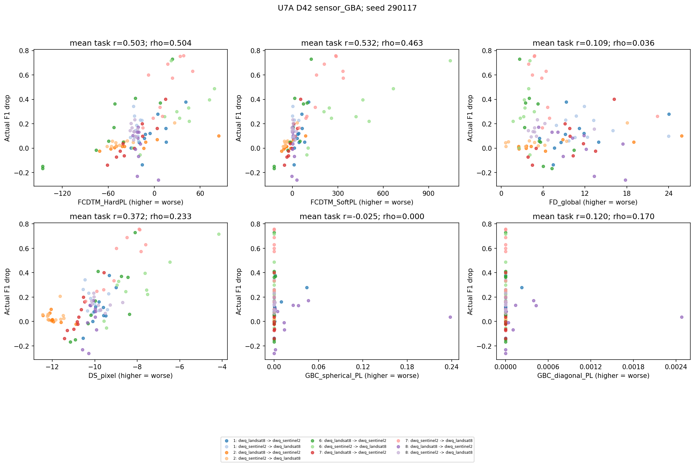
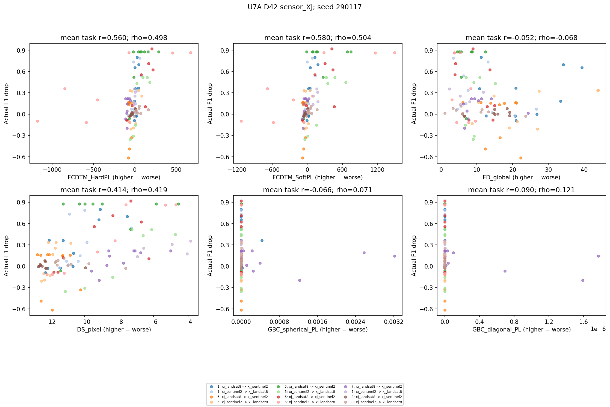
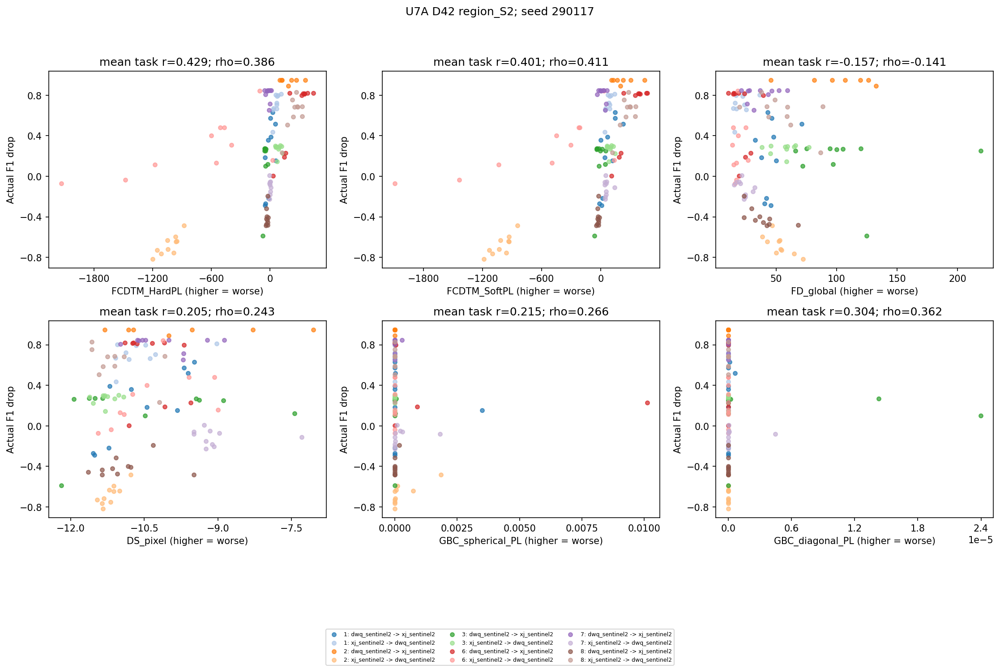
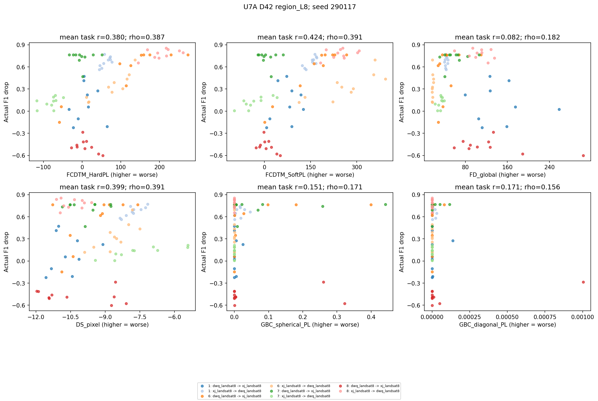

# U7A实验结果分析 通俗版

## 最重要的结论

**FCDTM伪标签版更能跟踪同一模型在不同图组上的表现变化，但本轮真正选择候选模型时，FD更好。因此不能写成FCDTM全面胜出。**

在正文补齐的42任务上，软FCDTM的Fisher汇总相关为0.6339，FD为−0.0294；但在相同的266个可计算候选选择配置中，按计划对类别—目标域及预算等权汇总，软FCDTM选中最优模型的比例约68.1%，FD约91.1%，平均选择遗憾分别为0.0419和0.0050。这里的配置是有限候选组在8／16／24张影像上的重复抽样，不是266个独立新区域。

这两种结果并不矛盾：一个指标可能擅长判断“这个模型在哪些图组上下降更多”，却不擅长比较“哪一个源模型更适合这个目标”。FD可能相反。两种能力需要分别陈述，不能只挑相关表下结论。FD为何在选模中有效还需后续按候选组、传感器和特征尺度分析，本轮不把它归因于某个未经检验的机制。

## 如何理解本轮结果

主表比较的是同一个冻结模型在不同目标图组上的精度下降变化，不是直接预测F1的具体数值。FCDTM硬/软版用模型自己的目标预测代替真实类别掩膜，保留原式的特征差异与头权重；因此是伪标签适配，不是原有监督版本的直接复现。

以下取正文声明补齐的42任务，在主要五方法共同可定义任务/种子上比较。越接近1的正相关，通常表示越能跟上真实下降变化；负值可能表示方向相反。源域/目标标签机会、采样和符号一致，但原生特征尺度不同，不能把这些数直接当F1下降量。

|方法中文名|Fisher汇总r|rho|
|---|---:|---:|
|FCDTM硬伪标签|0.6137|0.4637|
|FCDTM软伪标签|0.6339|0.4791|
|全局FD距离|-0.0294|0.0135|
|平方距离修正的DS|0.4780|0.3418|
|球形GBC伪标签|0.0953|0.1555|
|对角GBC伪标签（敏感性）|0.1879|0.2544|

这张表只能支持本轮方法之间的比较。具体跨传感器与跨地域结果见主表，不把总体较好写成每个类别都更好。GBC常量或缺类导致相关不可定义，覆盖详见CSV；不拿各方法不同有效任务的均值直接争胜。主表Fisher r与图上第一预设种子的原始r均值口径不同，数字不必相同。

还不能据此证明完整的返修创新性：本轮尚未运行审稿提出的ATC、DoC、LogME等新增对照（属于U7B），尚未用新架构或独立网格确认。软版优于硬版如有出现，只表示使用概率加权可能更有帮助，不证明伪标签真实正确，也不直接证明权重相对无权重的贡献；后者需U7C。原式保护/不保护结果、源均值接近0维度均留档。

模型选择是另一项检验：CSV保留同类同目标候选的遗憾、Top-1和不可算配置；它采用原生分数的预定方向作启发式选择，不能把它说成已经校准的目标F1预测。

## 先说明本轮验证什么

本轮比较论文已有的FD、DS、GBC和FCDTM。目标真实标签只在预测全部封存后用于核对答案。FCDTM硬/软版和GBC明确使用伪标签，因此不能冒称原版有标签方法。模型冻结不微调。当前仍是历史开发池，不是独立网格确认。

## 方法与读图

FCDTM硬版把目标预测前景作为特征分组；软版按前景概率加权。FD比较全部源/目标采样特征分布，不用类标签。DS按预测分组，用平方距离再取log，修正旧代码漏平方。GBC比较预测两类特征的重叠，源自作者负重叠和定义。全部方法共用每图2048个均匀采样像素和同一层特征。

横轴为方向统一后的原生分数，越大表示预期越差；纵轴是真实F1下降。它们不是同一单位，不画1:1。相关高说明同一模型在不同图组上的表现变化较一致，不等于具体F1估得准，也不自动代表更会筛选候选。

## 场景与指标名称怎么读

sensor_GBA＝大湾区跨传感器；sensor_XJ＝新疆跨传感器；region_S2＝Sentinel-2跨地域；region_L8＝Landsat 8跨地域。r看预测分数是否随真实下降一起变化；rho看同一任务各图组的下降顺序；它们越接近1通常越好。Fisher汇总先把每个r作变换再平均、最后变回来，避免直接平均相关系数；不是另一个F1分数。种子标准差反映随机分组敏感性，不是独立区域误差范围。

## 主要结果 D42清单

原论文表中37任务、正文声明42任务、现有扩展50任务分别报告，不能混用均值。这里用正文补齐42任务作为主清单。主要五方法使用共同可定义任务/种子交集，对角GBC是敏感性对照并单列覆盖。Pearson先做Fisher z再汇总，rho为任务均值；5个预设种子均报告，不挑最好seed。

|场景|方法|Fisher r|种子标准差|rho|有效相关数|
|---|---|---:|---:|---:|---:|
|all|FCDTM_HardPL|0.6137|0.0243|0.4637|210|
|all|FCDTM_SoftPL|0.6339|0.0257|0.4791|210|
|all|FD_global|-0.0294|0.0592|0.0135|210|
|all|DS_pixel|0.4780|0.0282|0.3418|210|
|all|GBC_spherical_PL|0.0953|0.0978|0.1555|210|
|all|GBC_diagonal_PL|0.1879|0.1027|0.2544|210|
|sensor_GBA|FCDTM_HardPL|0.7340|0.0475|0.5741|50|
|sensor_GBA|FCDTM_SoftPL|0.7165|0.0539|0.5207|50|
|sensor_GBA|FD_global|0.0793|0.0705|0.0890|50|
|sensor_GBA|DS_pixel|0.4626|0.0797|0.2912|50|
|sensor_GBA|GBC_spherical_PL|0.1292|0.1042|0.1656|50|
|sensor_GBA|GBC_diagonal_PL|0.3005|0.1026|0.3527|50|
|sensor_XJ|FCDTM_HardPL|0.6146|0.0635|0.4854|60|
|sensor_XJ|FCDTM_SoftPL|0.6710|0.0398|0.5410|60|
|sensor_XJ|FD_global|-0.1618|0.1828|-0.1257|60|
|sensor_XJ|DS_pixel|0.5597|0.0693|0.3912|60|
|sensor_XJ|GBC_spherical_PL|0.0346|0.1242|0.1088|60|
|sensor_XJ|GBC_diagonal_PL|0.0925|0.0955|0.1653|60|
|region_S2|FCDTM_HardPL|0.5224|0.0368|0.3762|60|
|region_S2|FCDTM_SoftPL|0.5264|0.0494|0.3896|60|
|region_S2|FD_global|-0.0691|0.1096|-0.0198|60|
|region_S2|DS_pixel|0.3608|0.0610|0.2825|60|
|region_S2|GBC_spherical_PL|0.1227|0.2007|0.2005|60|
|region_S2|GBC_diagonal_PL|0.2148|0.2421|0.3143|60|
|region_L8|FCDTM_HardPL|0.5470|0.0696|0.4243|40|
|region_L8|FCDTM_SoftPL|0.5959|0.0472|0.4685|40|
|region_L8|FD_global|0.1036|0.0562|0.1778|40|
|region_L8|DS_pixel|0.5157|0.0780|0.4200|40|
|region_L8|GBC_spherical_PL|0.0993|0.1275|0.1452|40|
|region_L8|GBC_diagonal_PL|0.1350|0.0704|0.1752|40|

## 不能忽略的限制

FCDTM源均值接近0的维度使用1e-6保护，另有不保护分数敏感性。空硬前景、GBC伪类样本不足、恒定分数分别记录，不以0替代失败；共同可算点和各方法自身覆盖见CSV。FD完整协方差、GBC球形与对角均已区分。r/rho不能当作AD预测误差，因此本轮不对原生分数计算MAE。原生分数选模只是启发式，最小AD不一定对应最大目标F1。目标F1越高越好，但不能用它调整分数方向。

每个seed每任务最多10个四图点，关联样本少且影像/模型重复，不称独立大样本显著性。5种子标准差不是独立区域置信区间。补充源模型簇区间、任务Kendall及合并相关见末节及CSV；配对显著性和独立确认仍未完成，不声称完整解决统计意见。U7B新增方法、源校准AD和新架构不属于本轮。

## 论文式总览图 D42主清单

所有50个逐任务图及PDF在artifacts/figures；每张使用第一预设种子，不挑图。不完整的后续统计仍列TODO，不用本轮对比代替独立确认。

## 补充 跨任务排序与不确定性

下表给出D42跨任务Kendall tau-b和按源模型簇重采样的描述性区间。合并相关容易受类别尺度影响，只作辅助。簇数有限，区间不证明独立新区域泛化；未做Holm配对显著性结论。

|方法|任务Kendall tau-b|模型簇Fisher r|95%重采样范围|
|---|---:|---:|---|
|FCDTM_HardPL|0.4146|0.6350|[0.4994, 0.7375]|
|FCDTM_SoftPL|0.4843|0.6462|[0.5158, 0.7450]|
|FD_global|0.0685|-0.0175|[-0.1496, 0.1239]|
|DS_pixel|0.2451|0.4775|[0.3107, 0.6256]|
|GBC_spherical_PL|-0.1429|0.1081|[0.0149, 0.2071]|
|GBC_diagonal_PL|-0.1127|0.2036|[0.1112, 0.2983]|

额外独立FD复核实际时序见[评价时序说明](评价时序说明.md)，相关尺度修正见[统计核对说明](统计核对说明.md)。所有预测哈希仍一致。

## 补充 候选模型是否选得更好

以下是D42中8/16/24图无标签预算，在主要五种方法均可计算的相同配置上比较。原生分数选模只是启发式，不是校准的F1预测；选中最优候选的比例越高越好，遗憾越低越好。方法不支持的配置数量也必须一起看。

|方法|共同配置数/全部多候选配置|平均遗憾|Top-1|最大损失|
|---|---:|---:|---:|---:|
|FCDTM_HardPL|266/270|0.0472|0.6466|0.5265|
|FCDTM_SoftPL|266/270|0.0419|0.6917|0.5265|
|FD_global|266/270|0.0050|0.9098|0.1961|
|DS_pixel|266/270|0.0672|0.5602|0.6471|
|GBC_spherical_PL|266/270|0.0500|0.6654|0.5082|

共同配置的条件结果不能替代全部部署覆盖；所有方法自身覆盖和失败配置原样保存在模型选择.csv。图区r为第一固定seed原始相关平均，主表为5seed的Fisher汇总，二者口径不同。

四张总览图仅含正文声明补齐的D42任务，与主结果表一致；50张逐任务图另外保留全类别扩展。类别编号及复现步骤见README。

## 按计划口径汇总的模型选择主结果

上面的共同配置表将266个配置等权，作为透明的原始汇总保留。正式选择主结果按计划先对同类别、同目标、同预算的重复抽样平均，再对预算和类别—目标组等权，因此Top-1会略有不同；不是重新运行模型或改变选中的候选。两种汇总均支持FD本轮选模优于FCDTM。完整三任务清单及两种权重见模型选择宏汇总.csv。

|方法|共同配置/全部|类别—目标组|平均选择遗憾↓|Top-1↑|最大损失↓|
|---|---:|---:|---:|---:|---:|
|FCDTM_HardPL|266/270|18|0.0469|0.6389|0.5265|
|FCDTM_SoftPL|266/270|18|0.0419|0.6815|0.5265|
|FD_global|266/270|18|0.0050|0.9111|0.1961|
|DS_pixel|266/270|18|0.0668|0.5519|0.6471|
|GBC_spherical_PL|266/270|18|0.0493|0.6704|0.5082|
