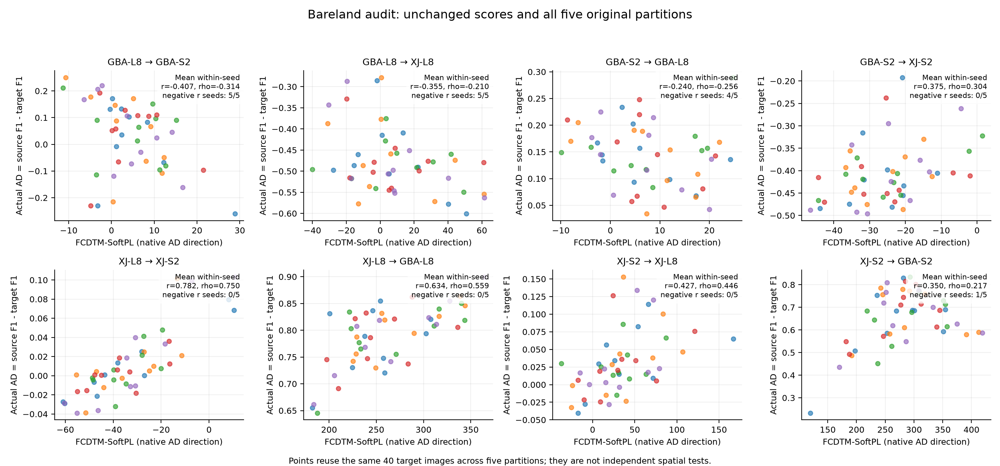

# 表X/XI Bareland负相关核查

## 核查结论

独立复算未发现这8行的抄表、符号、类别编号、模型缓存对应或F1计算错误。负数是度量与AD的负相关，不是负的分类精度；不能通过取绝对值或逐任务翻方向修正。模型表现和伪标签质量确有问题，属于方法适用性与模型质量问题。核查不能证明原训练流程、全部影像的配准或标签本身完全正确。

## 实际做了什么

- 4个checkpoint SHA一致；对4个源缓存及8个目标缓存各重推理第0张，共12张，与缓存特征/概率/预测核对通过。
- 评分阶段禁止目标标注/评价数据读取；从缓存特征独立重算528条Full2048记录、5种方法，再封存；未改旧模型或分数。
- 评价阶段重新读取256张源参考标签，核对采样标签与首张源图完整预测计数；重新读取目标标签复算8任务的TP/FP/FN、F1及AD。
- SciPy独立复算200个方法—任务—种子相关；核对表X/XI裸地8行80个数值，三位小数完全一致。
- F1/AD最大差异：0；各分数最大绝对差见verification.json。FD独立sqrtm在秩亏矩阵产生警告，但与旧PSD算法在预设容差内一致；不影响FCDTM的负相关结论。

## 模型本身的表现

|源模型|源参考F1|源参考采样真实前景占比|近零分母维数/总维数|
|---|---:|---:|---:|
|GBA-L8|0.395|8.20%|0/64|
|GBA-S2|0.498|7.25%|0/64|
|XJ-L8|0.956|70.90%|0/64|
|XJ-S2|0.960|69.41%|0/64|

源F1基于固定64张参考图的合并像素；采样占比仅用于诊断。大湾区裸地模型的源参考F1明显低于新疆模型。不能将相关性的负号简单归咎于程序，也不能将低F1解释为其唯一原因。

## 8个任务的完整40图表现

|源→目标|源F1|目标F1|AD|精确率|召回率|真实裸地占比|预测裸地占比|
|---|---:|---:|---:|---:|---:|---:|---:|
|GBA-L8→GBA-S2|0.395|0.367|0.028|0.271|0.567|7.28%|15.25%|
|GBA-L8→XJ-L8|0.395|0.879|-0.484|0.809|0.961|70.51%|83.73%|
|GBA-S2→GBA-L8|0.498|0.355|0.143|0.267|0.529|8.16%|16.16%|
|GBA-S2→XJ-S2|0.498|0.915|-0.417|0.886|0.947|63.79%|68.18%|
|XJ-L8→XJ-S2|0.956|0.952|0.004|0.946|0.959|63.79%|64.62%|
|XJ-L8→GBA-L8|0.956|0.171|0.785|0.256|0.129|8.16%|4.10%|
|XJ-S2→XJ-L8|0.960|0.936|0.024|0.910|0.963|70.51%|74.59%|
|XJ-S2→GBA-S2|0.960|0.302|0.657|0.235|0.424|7.28%|13.14%|

AD为负表示目标F1高于源参考F1，与相关系数为负不是一回事。预测前景与真实前景占比差异，以及精确率/召回率失衡，说明仅用预测前景的均值不一定能代表真实分类错误。

## 表格负相关是否稳定，以及伪标签的作用

|源→目标|硬版r|软版r|软版ρ|软版负r种子/5|真实前景均值诊断r|
|---|---:|---:|---:|---:|---:|
|GBA-L8→GBA-S2|-0.491|-0.407|-0.314|5/5|0.008|
|GBA-L8→XJ-L8|-0.356|-0.355|-0.210|5/5|-0.295|
|GBA-S2→GBA-L8|0.112|-0.240|-0.256|4/5|0.172|
|GBA-S2→XJ-S2|0.249|0.375|0.304|0/5|0.479|
|XJ-L8→XJ-S2|0.756|0.782|0.750|0/5|0.674|
|XJ-L8→GBA-L8|0.685|0.634|0.559|0/5|0.750|
|XJ-S2→XJ-L8|0.401|0.427|0.446|0/5|0.493|
|XJ-S2→GBA-S2|0.381|0.350|0.217|1/5|0.406|

“真实前景均值诊断”仅在封存后，将目标前景均值换为真实标签分组，其余源均值、权重及方向不变。它仅用于解释原因，违反本分支预测时的零目标标签约束，不能列作新的无标签预测方法，也不能据此调参。

## 三个关键失败案例

大湾区L8→大湾区S2：软版r=-0.407，5个种子均为负。目标精确率仅0.271，预测裸地15.25%，真实裸地7.28%，预测前景受到大量误报污染。换真实前景均值后r约0.008，只是接近无关联，并未恢复有效预测。

大湾区S2→大湾区L8：软版r=-0.240（4/5种子为负），硬版却为0.112。换真实前景均值后r约0.172，提示软概率加权与伪标签偏差会影响结果；但这不能证明调整伪标签就能稳定解决问题。

大湾区L8→新疆L8：软版r=-0.355，5个种子均为负；使用真实前景均值后仍为-0.295。此任务完整目标F1反而高达0.879、源参考F1仅0.395，说明不能把负相关简单解释为目标模型整体精度很差，或全部归因于伪标签污染。原有带符号的前景加权均值变化也不保证随F1下降单调增加。

四个模型均无源均值绝对值小于1e-6的特征维度（0/64），且FCDTM独立重算误差至多约5.7e-13，本次没有支持“近零分母数值爆炸导致负相关”的证据。

## 如何解释和处理

1. 伪标签前景并不等于真实裸地；在模型较弱或漏报严重时，预测前景均值可能主要反映“模型挑出的部分裸地”，而非全部裸地的迁移变化。
2. F1同时由误报与漏报决定；当前FCDTM以目标前景均值为主，不能保证其带符号的加权变化与F1下降在每个任务上同向。真实前景诊断可区分伪标签偏差与原度量本身的限制，但不构成因果证明。
3. 每个种子仅10个四图批次，且5个种子重用同40图；负号的重复情况属于划分敏感性，不能当作5次独立空间验证。
4. 所有任务保留原方向及负相关结果。后续应在独立数据上做弱模型、伪标签可靠性、背景误报/前景漏报和权重消融；不能为了转正而在这些目标结果上选择符号或参数。

复现：服务器运行code/audit_bareland.py（依赖原U7B缓存、GDAL、PyTorch、SciPy）；绘图及逐单元核查运行code/summarize_bareland.py --paper /本地/fcdtm-label-free。
